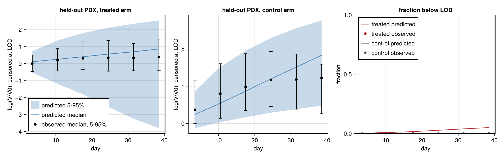
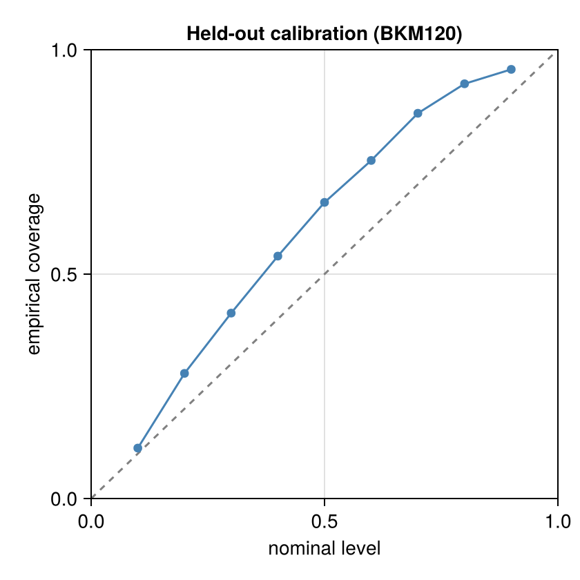
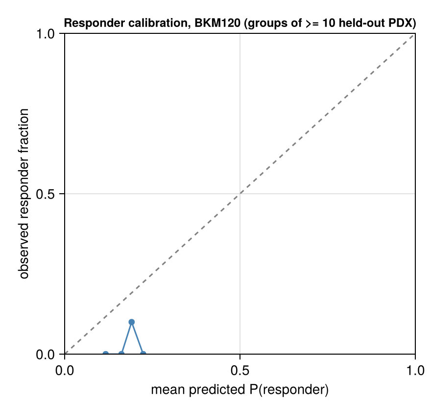

# Validation: BKM120

Generated 2026-11-05 13:29. Frozen split frac 0.2, seed 1: 40 held-out of 197 paired PDX for this drug; 200 common predictive draws.

Design: the **primary** fit (frozen stratified 80% of PDX, days ≤ 42 only) predicts the held-out 20% PDX; held-out PDX are therefore scored on days ≤ 42 only, and the observed response categories below are recomputed on that window. The **late21** fit (same 80%, days ≤ 21) forecasts days 22–42 of its training PDX. Observation model: Student-t on log volume, censored at the detection limit. This report is aggregated: every bin and summary pools at least 10 PDX models, and there are no individual PDX ids or observations (the licensed PDXE data are not redistributed); individual-curve figures are written to the local output directory only.

## Held-out PDX predictive check (primary fit; new PDX, fresh random effects, days ≤ 42)

**New-PDX prediction**: 685 scored points (0 undetectable, scored as left-censored at LOD 4.0 mm³ in the LPD only), 80 curves, 40 PDX models; nominal level 90.0%; observation model Student-t, ν = 5.0.

| metric | value |
|---|---|
| coverage, pooled | 95.6% (PDX-cluster bootstrap 95% CI 92.5%–98.3%) |
| coverage, PDX-averaged (each PDX weighted equally) | 93.6% |
| mean interval width (log-volume) | 2.779 (NaN for 0 points) |
| mean log predictive density, finite scores (volume scale) | -6.833 over 685 points |
| LPD scores equal to -Inf (no valid draw), kept | 0; mean over all scored points incl. these: -6.8327857017501765 |
| mean CRPS (mm³) | 167.026 (NaN for 0 points) |
| failed solves | 0 draw rows with non-finite values; 0 empty ensembles (counted as coverage misses) |

### log(V/V0) by day, with noise and censoring

Pooled over PDX × posterior draws; both observed and simulated volumes censored at the LOD; log(V/V0) with V0 the observed baseline. Quantiles are 5% / 50% / 95%.

| arm | days | n obs | observed log(V/V0) | predicted log(V/V0) | observed < LOD | predicted < LOD | 90% coverage |
|---|---|---|---|---|---|---|---|
| treated | 0–7 | 71 | -0.47 / 0.00 / 0.50 | -0.54 / 0.11 / 0.73 | 0.0% | 0.2% | 97.2% |
| treated | 7–14 | 75 | -0.44 / 0.21 / 0.88 | -1.19 / 0.25 / 1.36 | 0.0% | 0.8% | 100.0% |
| treated | 14–21 | 69 | -0.34 / 0.31 / 1.27 | -1.81 / 0.40 / 1.79 | 0.0% | 1.6% | 100.0% |
| treated | 21–28 | 63 | -0.44 / 0.34 / 1.36 | -2.55 / 0.56 / 2.11 | 0.0% | 2.7% | 100.0% |
| treated | 28–35 | 49 | -0.43 / 0.34 / 1.19 | -3.25 / 0.69 / 2.34 | 0.0% | 3.9% | 100.0% |
| treated | 35–42 | 47 | -0.39 / 0.38 / 1.45 | -3.80 / 0.86 / 2.54 | 0.0% | 5.0% | 100.0% |
| control | 0–7 | 68 | -0.01 / 0.37 / 1.16 | -0.13 / 0.25 / 0.88 | 0.0% | 0.0% | 83.8% |
| control | 7–14 | 69 | 0.14 / 0.81 / 1.63 | 0.04 / 0.55 / 1.55 | 0.0% | 0.0% | 91.3% |
| control | 14–21 | 68 | 0.36 / 1.00 / 1.90 | 0.17 / 0.88 / 1.98 | 0.0% | 0.0% | 94.1% |
| control | 21–28 | 52 | 0.46 / 1.19 / 1.96 | 0.29 / 1.22 / 2.34 | 0.0% | 0.0% | 96.2% |
| control | 28–35 | 30 | 0.39 / 1.20 / 1.89 | 0.39 / 1.54 / 2.60 | 0.0% | 0.0% | 93.3% |
| control | 35–42 | 24 | 0.27 / 1.24 / 1.62 | 0.49 / 1.86 / 2.81 | 0.0% | 0.0% | 87.5% |

### Response categories on held-out PDX (PDXE rules, Gao et al. 2015)

Observed and predicted categories use `pdxe_response_paper` (windows t > 10, short curves on all points) on the days ≤ 42 record; simulated volumes below the LOD are recorded as 0 like the data. This rule reproduces the published BestAvgResponse in 98.4% of PDXE curves but its BestResponse is systematically lower than the published one in ~40% of curves (published mPD scored mSD by the rule): 4-way agreement with the published labels is ~91%, responder vs non-responder ~99.9%.

Observed category counts (mCR/mPR/mSD/mPD): 0/1/24/15 over 40 held-out PDX.

| metric | value |
|---|---|
| Kendall τ_b (predicted expected ordinal score vs observed ordinal) | 0.415 |
| AUROC responder (mCR/mPR) vs rest, ranked by predicted P(responder) | 0.603 (same score; cluster-bootstrap 95% CI 0.453–0.754) |
| modal predicted category = observed category | 42.5% |
| vs the published (full follow-up) categories: τ_b / AUROC | 0.362 / 0.603 (n=40) |
| predicted responder fraction (common posterior draws across models) | 17.3% (7.5%–27.5%); 0 failed model-draws excluded |
| observed responder fraction | 2.5% |

Confusion matrix (rows observed, columns modal predicted category):

| | mCR | mPR | mSD | mPD |
|---|---|---|---|---|
| mCR | 0 | 0 | 0 | 0 |
| mPR | 0 | 0 | 0 | 1 |
| mSD | 0 | 0 | 5 | 19 |
| mPD | 0 | 0 | 3 | 12 |

## Forecast of days 22–42 from the late21 fit (known tumours)

**Late-21 forecast**: 1061 scored points (10 undetectable, scored as left-censored at LOD 4.0 mm³ in the LPD only), 262 curves, 146 PDX models; nominal level 90.0%; observation model Student-t, ν = 5.0.

| metric | value |
|---|---|
| coverage, pooled | 74.5% (PDX-cluster bootstrap 95% CI 69.8%–78.8%) |
| coverage, PDX-averaged (each PDX weighted equally) | 74.1% |
| mean interval width (log-volume) | 0.684 (NaN for 0 points) |
| mean log predictive density, finite scores (volume scale) | -6.476 over 1071 points |
| LPD scores equal to -Inf (no valid draw), kept | 0; mean over all scored points incl. these: -6.475645728867733 |
| mean CRPS (mm³) | 103.315 (NaN for 0 points) |
| failed solves | 0 draw rows with non-finite values; 0 empty ensembles (counted as coverage misses) |

### log(V/V0) by day, late-21 forecast

Pooled over PDX × posterior draws; both observed and simulated volumes censored at the LOD; log(V/V0) with V0 the observed baseline. Quantiles are 5% / 50% / 95%.

| arm | days | n obs | observed log(V/V0) | predicted log(V/V0) | observed < LOD | predicted < LOD | 90% coverage |
|---|---|---|---|---|---|---|---|
| treated | 21–28 | 237 | -0.69 / 0.41 / 1.35 | -1.04 / 0.38 / 1.36 | 0.8% | 0.8% | 82.1% |
| treated | 28–35 | 198 | -0.99 / 0.36 / 1.27 | -1.60 / 0.28 / 1.35 | 1.5% | 1.5% | 69.2% |
| treated | 35–42 | 166 | -1.03 / 0.35 / 1.11 | -2.04 / 0.25 / 1.35 | 2.4% | 1.3% | 63.6% |
| control | 21–28 | 205 | 0.24 / 1.15 / 1.81 | 0.29 / 1.18 / 1.98 | 0.0% | 0.0% | 85.4% |
| control | 28–35 | 159 | 0.25 / 1.18 / 1.87 | 0.28 / 1.30 / 2.13 | 0.0% | 0.0% | 71.7% |
| control | 35–42 | 106 | 0.19 / 1.20 / 1.78 | 0.36 / 1.39 / 2.26 | 0.9% | 0.0% | 66.7% |

## Convergence

**Primary fit** (8 chains, 2000 stored draws, 250 per chain)

| item | recorded by the fit |
|---|---|
| max R-hat (all parameters) | 1.028 |
| min bulk ESS | 294.9 |
| min tail ESS | 95.46 |
| divergent transitions | 0 |
| E-BFMI (min over chains) | 0.658 |
| tree-depth cap hits | 0 |
| mean tree depth | 7.25 |
| mean acceptance | 0.8222 |
| mean step size | 0.03634 |
| mean leapfrog steps | 159.1 |
| cross-mode R-hat | 1.026 |
| MAP log-densities of the starts | [728.5749203757681, 157.88817758902624, 740.6376683740195, 750.5754235380638, 740.0445144551471] |
| mode_lps | [750.5754235380638, 740.6376683740195, 740.0445144551471, 728.5749203757681] |
| rhat_by_warmup_chain | 1.026 |

Recomputed from the stored draws of the hyperparameters (chain layout from `nchains`):

| parameter | R-hat | bulk ESS | tail ESS |
|---|---|---|---|
| μ_λ0 | 1.004 | 1696 | 1400 |
| ω_λ0 | 1.004 | 1532 | 1289 |
| μ_k2 | 1.006 | 1943 | 1537 |
| ω_k2 | 1.003 | 1416 | 1389 |
| logλ1 | 1.009 | 738 | 714 |
| logk1 | 1.024 | 743 | 127 |
| σ | 1.010 | 819 | 820 |

**Convergence flags: max R-hat 1.028 > 1.01; min bulk ESS 294.9 < 100 per chain; cross-mode R-hat 1.026 > 1.01; recomputed hyperparameter R-hat > 1.01**

**Late-21 fit** (8 chains, 2000 stored draws, 250 per chain)

| item | recorded by the fit |
|---|---|
| max R-hat (all parameters) | 1.625 |
| min bulk ESS | 13.81 |
| min tail ESS | 49.93 |
| divergent transitions | 0 |
| E-BFMI (min over chains) | 0.6649 |
| tree-depth cap hits | 0 |
| mean tree depth | 6.684 |
| mean acceptance | 0.8412 |
| mean step size | 0.06282 |
| mean leapfrog steps | 109.8 |
| cross-mode R-hat | 1.609 |
| MAP log-densities of the starts | [412.3413020296406, 408.5529364608676, 417.50547586024726, 422.06298555575376, 411.65141513445013] |
| mode_lps | [422.06298555575376, 417.50547586024726, 412.3413020296406, 411.65141513445013, 408.5529364608676] |
| rhat_by_warmup_chain | 1.609 |

Recomputed from the stored draws of the hyperparameters (chain layout from `nchains`):

| parameter | R-hat | bulk ESS | tail ESS |
|---|---|---|---|
| μ_λ0 | 1.010 | 2324 | 1066 |
| ω_λ0 | 1.272 | 22 | 391 |
| μ_k2 | 1.005 | 1906 | 1717 |
| ω_k2 | 1.094 | 57 | 1512 |
| logλ1 | 1.428 | 17 | 52 |
| logk1 | 1.008 | 1800 | 908 |
| σ | 1.007 | 1232 | 1505 |

**Convergence flags: max R-hat 1.625 > 1.01; min bulk ESS 13.81 < 100 per chain; cross-mode R-hat 1.609 > 1.01; recomputed hyperparameter R-hat > 1.01**

## PSIS-LOO (primary fit, training PDX, days ≤ 42)

**Conditional, one unit per PDX model (random effects fixed at their draws)**: elpd = 941.2 ± 118.8, p_eff = 546.3, n = 157; Pareto-k ≤0.5 / 0.5–0.7 / 0.7–1 / >1: 0/2/67/88. Units with k > 0.7 need exact refits before trusting elpd.

Marginal, one unit per PDX model (random effects integrated; new-PDX LOO): not computed.

## Figures

