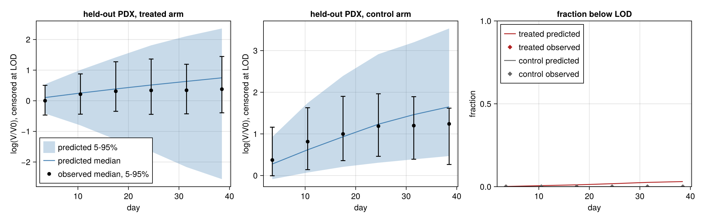
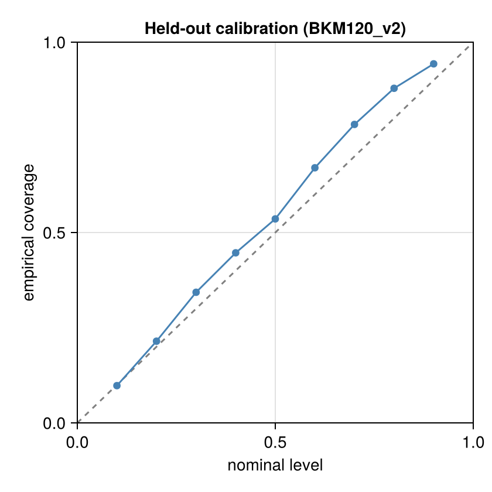
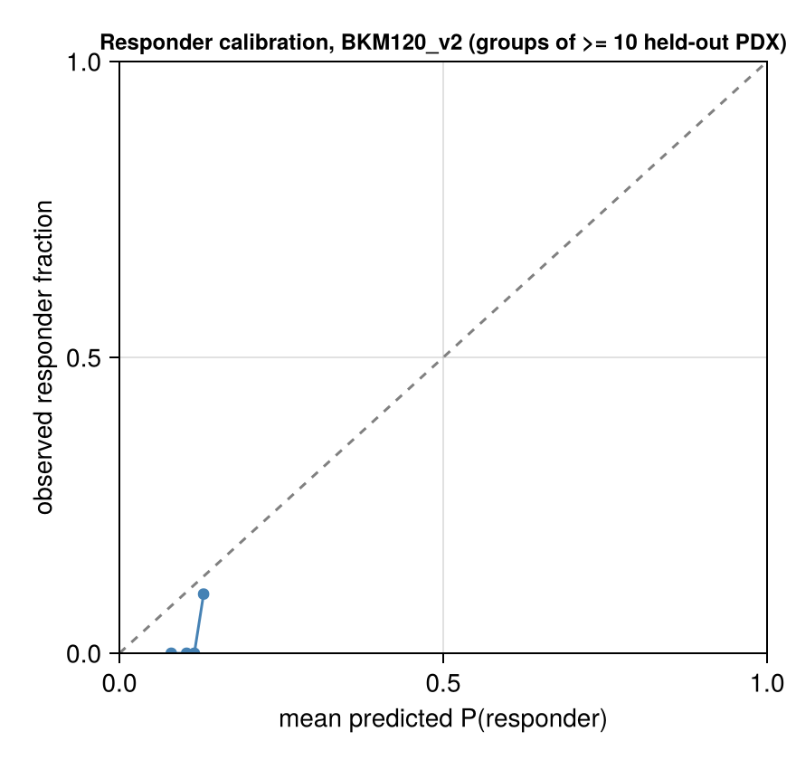

# Validation: BKM120_v2

Generated 2026-11-08 12:02. Fits: `fits` (files `*_v2.jld2`). Model: v2. Frozen split frac 0.2, seed 1: 40 held-out of 197 paired PDX for this drug. Predictive draws used (of 2000 / 2000 stored in the primary / late21 fit): 200 for the held-out curve check, 200 for the late21 forecast, 1000 for the response section.

Design: the **primary** fit (frozen stratified 80% of PDX, days ≤ 42 only) predicts the held-out 20% PDX; held-out PDX are therefore scored on days ≤ 42 only, and the observed response categories below are recomputed on that window. The **late21** fit (same 80%, days ≤ 21) forecasts days 22–42 of its training PDX. Observation model: Student-t on log volume, censored at the detection limit. This report is aggregated: every bin and summary pools at least 10 PDX models, and there are no individual PDX ids or observations (the licensed PDXE data are not redistributed); individual-curve figures are written to the local output directory only.

## Held-out PDX predictive check (primary fit; new PDX, fresh random effects, days ≤ 42)

**New-PDX prediction**: 685 scored points (0 undetectable, scored as left-censored at LOD 4.0 mm³ in the LPD only), 80 curves, 40 PDX models; nominal level 90.0%; observation model Student-t, ν = 5.0.

| metric | value |
|---|---|
| coverage, pooled | 94.3% (PDX-cluster bootstrap 95% CI 90.3%–97.3%) |
| coverage, PDX-averaged (each PDX weighted equally) | 91.6% |
| mean interval width (log-volume) | 2.377 (NaN for 0 points) |
| mean log predictive density, finite scores (volume scale) | -6.718 over 685 points |
| LPD scores equal to -Inf (no valid draw), kept | 0; mean over all scored points incl. these: -6.718171112251272 |
| mean CRPS (mm³) | 153.077 (NaN for 0 points) |
| failed solves | 0 draw rows with non-finite values; 0 empty ensembles (counted as coverage misses) |

### log(V/V0) by day, with noise and censoring

Pooled over PDX × posterior draws; both observed and simulated volumes censored at the LOD; log(V/V0) with V0 the observed baseline. Quantiles are 5% / 50% / 95%. Tail calibration: fraction of observed positive volumes below the predictive 5% quantile / above the 95% quantile (nominal 5% / 5%). Below the 5% quantile = tumours smaller than predicted (they shrink more or grow less than the predictive lower tail allows); excess regrowth shows in the upper tail (above the 95% quantile).

| arm | days | n obs (PDX) | observed log(V/V0) | predicted log(V/V0) | observed < LOD | predicted < LOD | 90% coverage | below 5% / above 95% |
|---|---|---|---|---|---|---|---|---|
| treated | 0–7 | 71 (40) | -0.47 / 0.00 / 0.50 | -0.42 / 0.10 / 0.54 | 0.0% | 0.1% | 90.1% | 5.6% / 4.2% |
| treated | 7–14 | 75 (40) | -0.44 / 0.21 / 0.88 | -0.80 / 0.25 / 1.00 | 0.0% | 0.6% | 96.0% | 0.0% / 4.0% |
| treated | 14–21 | 69 (37) | -0.34 / 0.31 / 1.27 | -1.27 / 0.39 / 1.42 | 0.0% | 1.1% | 97.1% | 0.0% / 2.9% |
| treated | 21–28 | 63 (35) | -0.44 / 0.34 / 1.36 | -1.66 / 0.51 / 1.81 | 0.0% | 1.8% | 100.0% | 0.0% / 0.0% |
| treated | 28–35 | 49 (27) | -0.43 / 0.34 / 1.19 | -2.17 / 0.63 / 2.11 | 0.0% | 2.6% | 100.0% | 0.0% / 0.0% |
| treated | 35–42 | 47 (26) | -0.39 / 0.38 / 1.45 | -2.56 / 0.75 / 2.36 | 0.0% | 3.1% | 100.0% | 0.0% / 0.0% |
| control | 0–7 | 68 (39) | -0.01 / 0.37 / 1.16 | -0.09 / 0.28 / 0.93 | 0.0% | 0.0% | 85.3% | 2.9% / 11.8% |
| control | 7–14 | 69 (39) | 0.14 / 0.81 / 1.63 | 0.07 / 0.62 / 1.74 | 0.0% | 0.0% | 91.3% | 2.9% / 5.8% |
| control | 14–21 | 68 (35) | 0.36 / 1.00 / 1.90 | 0.21 / 0.93 / 2.39 | 0.0% | 0.0% | 95.6% | 4.4% / 0.0% |
| control | 21–28 | 52 (29) | 0.46 / 1.19 / 1.96 | 0.31 / 1.23 / 2.92 | 0.0% | 0.0% | 94.2% | 5.8% / 0.0% |
| control | 28–35 | 30 (19) | 0.39 / 1.20 / 1.89 | 0.39 / 1.46 / 3.20 | 0.0% | 0.0% | 93.3% | 6.7% / 0.0% |
| control | 35–42 | 24 (15) | 0.27 / 1.24 / 1.62 | 0.47 / 1.65 / 3.53 | 0.0% | 0.0% | 87.5% | 12.5% / 0.0% |

### Residuals by day, held-out PDX

Median signed log residual, `log y - median log(predictive)` per observation, reduced to one median per PDX in the bin, then the median across PDX (each PDX equal weight; 90% PDX-bootstrap interval). The balanced-panel column uses only PDX observed in every bin of the arm, so changes between bins are within-PDX rather than a changing mix of PDX. Positive = observed larger than predicted.

| arm | days | PDX | median residual (90% interval) | balanced panel (PDX) median residual |
|---|---|---|---|---|
| treated | 0–7 | 40 | -0.086 (-0.149, +0.027) | -0.149 (26) |
| treated | 7–14 | 40 | -0.065 (-0.175, +0.077) | -0.222 (26) |
| treated | 14–21 | 37 | -0.140 (-0.239, +0.028) | -0.253 (26) |
| treated | 21–28 | 35 | -0.152 (-0.350, +0.098) | -0.342 (26) |
| treated | 28–35 | 27 | -0.359 (-0.460, -0.189) | -0.365 (26) |
| treated | 35–42 | 26 | -0.360 (-0.497, -0.091) | -0.360 (26) |
| control | 0–7 | 39 | +0.108 (+0.013, +0.190) | -0.055 (14) |
| control | 7–14 | 39 | +0.180 (+0.036, +0.386) | -0.106 (14) |
| control | 14–21 | 35 | +0.126 (-0.015, +0.397) | -0.261 (14) |
| control | 21–28 | 29 | -0.002 (-0.133, +0.216) | -0.294 (14) |
| control | 28–35 | 19 | -0.295 (-0.431, -0.167) | -0.427 (14) |
| control | 35–42 | 15 | -0.383 (-0.803, -0.216) | -0.339 (14) |

### Response categories on held-out PDX (PDXE rules, Gao et al. 2015)

Observed and predicted categories use `pdxe_response_paper` (windows t > 10, short curves on all points) on the days ≤ 42 record; simulated volumes below the LOD are recorded as 0 like the data and the day-0 volume is the observed one. This rule reproduces the published BestAvgResponse in 98.4% of PDXE curves but its BestResponse is systematically lower than the published one in ~40% of curves (published mPD scored mSD by the rule): 4-way agreement with the published labels is ~91%, responder vs non-responder ~99.9%.

**Recorded response** = categories of simulated noisy observations (the prediction of what would be recorded). **Latent response** = categories of the noise-free trajectories, every draw classified; it is a sensitivity line that isolates the contribution of observation noise (same random effects, same LOD recording and baseline convention), not a prediction of recorded categories. 1000 common posterior draws; response section runtime 146.3 s.

Observed category counts (mCR/mPR/mSD/mPD): 0/1/24/15 over 40 held-out PDX (1 responder).

Responder fractions (all intervals are **posterior predictive, including finite-cohort variability**, 90%):

| | held-out PDX (new, n=40) | training PDX (known random effects, in-sample, n=157) |
|---|---|---|
| observed responder fraction | 2.5% | 7.6% |
| predicted, recorded response (noisy) | 10.7% (2.5%–20.0%) | 6.3% (5.1%–7.6%) |
| predicted, latent response (noise-free) | 10.2% (2.5%–20.0%) | 5.6% (5.1%–5.7%) |

0 failed model-draws excluded (held-out, recorded).

| metric | value |
|---|---|
| Kendall τ_b (predicted expected ordinal score vs observed ordinal) | 0.226 (latent: 0.205) |
| AUROC responder (mCR/mPR) vs rest, ranked by predicted P(responder) | 1.000 (same score; cluster-bootstrap 95% CI 1.000–1.000; 34.1% of replicates had no responder or no non-responder and were dropped; latent: 1.000) |
| constant-risk benchmark | AUROC 0.5 by construction. Brier score: model 0.030; constant risk at the mean predicted P(responder) = 0.107: 0.031; prevalence-oracle reference 0.024 |
| modal predicted category = observed category | 50.0% |
| vs the published (full follow-up) categories: τ_b / AUROC | 0.100 / 1.000 (n=40) |

**No demonstrated responder discrimination for new PDX (exchangeable random effects, no covariates). Only one held-out responder: the AUROC is just the rank of that single PDX, and the cluster bootstrap conditional on one positive PDX is not informative (its interval is not evidence of discrimination).**

Confusion matrix (rows observed, columns modal predicted category):

| | mCR | mPR | mSD | mPD |
|---|---|---|---|---|
| mCR | 0 | 0 | 0 | 0 |
| mPR | 0 | 0 | 1 | 0 |
| mSD | 0 | 0 | 17 | 7 |
| mPD | 0 | 0 | 12 | 3 |

## Forecast of days 22–42 from the late21 fit (known tumours)

**Late-21 forecast**: 1061 scored points (10 undetectable, scored as left-censored at LOD 4.0 mm³ in the LPD only), 262 curves, 144 PDX models; nominal level 90.0%; observation model Student-t, ν = 5.0.

| metric | value |
|---|---|
| coverage, pooled | 81.1% (PDX-cluster bootstrap 95% CI 77.3%–84.6%) |
| coverage, PDX-averaged (each PDX weighted equally) | 80.3% |
| mean interval width (log-volume) | 0.660 (NaN for 0 points) |
| mean log predictive density, finite scores (volume scale) | -6.234 over 1071 points |
| LPD scores equal to -Inf (no valid draw), kept | 0; mean over all scored points incl. these: -6.233659486098249 |
| mean CRPS (mm³) | 78.671 (NaN for 0 points) |
| failed solves | 0 draw rows with non-finite values; 0 empty ensembles (counted as coverage misses) |

### log(V/V0) by day, late-21 forecast

Pooled over PDX × posterior draws; both observed and simulated volumes censored at the LOD; log(V/V0) with V0 the observed baseline. Quantiles are 5% / 50% / 95%. Tail calibration: fraction of observed positive volumes below the predictive 5% quantile / above the 95% quantile (nominal 5% / 5%). Below the 5% quantile = tumours smaller than predicted (they shrink more or grow less than the predictive lower tail allows); excess regrowth shows in the upper tail (above the 95% quantile).

| arm | days | n obs (PDX) | observed log(V/V0) | predicted log(V/V0) | observed < LOD | predicted < LOD | 90% coverage | below 5% / above 95% |
|---|---|---|---|---|---|---|---|---|
| treated | 21–28 | 237 (135) | -0.69 / 0.41 / 1.35 | -0.92 / 0.36 / 1.30 | 0.8% | 0.8% | 85.5% | 2.6% / 11.9% |
| treated | 28–35 | 198 (107) | -0.99 / 0.36 / 1.27 | -1.24 / 0.26 / 1.21 | 1.5% | 1.5% | 69.7% | 6.2% / 24.1% |
| treated | 35–42 | 166 (93) | -1.03 / 0.35 / 1.11 | -1.42 / 0.22 / 1.17 | 2.4% | 1.2% | 66.7% | 7.4% / 25.9% |
| control | 21–28 | 205 (118) | 0.24 / 1.15 / 1.81 | 0.23 / 1.10 / 1.85 | 0.0% | 0.0% | 91.2% | 2.9% / 5.9% |
| control | 28–35 | 159 (93) | 0.25 / 1.18 / 1.87 | 0.17 / 1.14 / 1.90 | 0.0% | 0.0% | 86.2% | 6.9% / 6.9% |
| control | 35–42 | 106 (66) | 0.19 / 1.20 / 1.78 | 0.22 / 1.17 / 1.96 | 0.9% | 0.0% | 87.6% | 8.6% / 3.8% |

### Within-PDX residuals by day, late-21 forecast

Median signed log residual, `log y - median log(predictive)` per observation, reduced to one median per PDX in the bin, then the median across PDX (each PDX equal weight; 90% PDX-bootstrap interval). The balanced-panel column uses only PDX observed in every bin of the arm, so changes between bins are within-PDX rather than a changing mix of PDX. Positive = observed larger than predicted.

| arm | days | PDX | median residual (90% interval) | balanced panel (PDX) median residual |
|---|---|---|---|---|
| treated | 21–28 | 134 | +0.067 (+0.050, +0.091) | +0.062 (87) |
| treated | 28–35 | 106 | +0.072 (+0.034, +0.162) | +0.052 (87) |
| treated | 35–42 | 91 | +0.116 (+0.044, +0.215) | +0.094 (87) |
| control | 21–28 | 118 | +0.014 (-0.014, +0.037) | -0.000 (59) |
| control | 28–35 | 93 | +0.033 (-0.006, +0.082) | -0.006 (59) |
| control | 35–42 | 65 | -0.016 (-0.068, +0.063) | -0.003 (59) |

## Convergence

**Primary fit** (8 chains, 2000 stored draws, 250 per chain)

| item | recorded by the fit |
|---|---|
| max R-hat (all parameters) | 1.608 |
| min bulk ESS | 13.85 |
| min tail ESS | 32.94 |
| divergent transitions | 0 |
| E-BFMI (min over chains) | 0.608 |
| tree-depth cap hits | 0 |
| mean tree depth | 8 |
| mean acceptance | 0.8871 |
| mean step size | 0.02161 |
| mean leapfrog steps | 255 |
| cross-mode R-hat | NaN |
| MAP log-densities of the starts | [887.0568507817999, 803.3574512020899, 668.5376659090346, 826.5139379845288, 830.325314983477] |
| mode_gap | Inf |
| mode_lps | [887.0568507817999] |
| rhat_by_warmup_chain | 1.634 |

Recomputed from the stored draws of the hyperparameters (chain layout from `nchains`):

| parameter | R-hat | bulk ESS | tail ESS |
|---|---|---|---|
| μ_λ0 | 1.010 | 833 | 1330 |
| ω_λ0 | 1.022 | 304 | 1192 |
| μ_k2 | 1.001 | 2270 | 1474 |
| ω_k2 | 1.007 | 1322 | 1930 |
| logλ1 | 1.007 | 666 | 1514 |
| logk1 | 1.002 | 4154 | 1550 |
| σ | 1.003 | 1894 | 1678 |
| corr(log λ0, log k2) | 1.013 | 1067 | 1365 |
| μ_logVtr | 1.013 | 421 | 890 |
| ω_Vtr | 1.012 | 627 | 980 |

**Convergence flags: max R-hat 1.608 > 1.01; min bulk ESS 13.85 < 100 per chain; recomputed hyperparameter R-hat > 1.01**

**Late-21 fit** (8 chains, 2000 stored draws, 250 per chain)

| item | recorded by the fit |
|---|---|
| max R-hat (all parameters) | 1.186 |
| min bulk ESS | 32.01 |
| min tail ESS | 10.56 |
| divergent transitions | 0 |
| E-BFMI (min over chains) | 0.6627 |
| tree-depth cap hits | 0 |
| mean tree depth | 7.252 |
| mean acceptance | 0.8706 |
| mean step size | 0.02886 |
| mean leapfrog steps | 163 |
| cross-mode R-hat | 1.084 |
| MAP log-densities of the starts | [415.50136284334354, 414.73479727124163, 360.85999949140927, 409.90036687014725, 406.9965784578937] |
| mode_gap | Inf |
| mode_lps | [415.50136284334354, 414.73479727124163, 409.90036687014725, 406.9965784578937] |
| rhat_by_warmup_chain | 1.084 |

Recomputed from the stored draws of the hyperparameters (chain layout from `nchains`):

| parameter | R-hat | bulk ESS | tail ESS |
|---|---|---|---|
| μ_λ0 | 1.048 | 200 | 564 |
| ω_λ0 | 1.061 | 101 | 114 |
| μ_k2 | 1.008 | 762 | 1433 |
| ω_k2 | 1.004 | 956 | 1429 |
| logλ1 | 1.027 | 348 | 791 |
| logk1 | 1.003 | 3075 | 1277 |
| σ | 1.003 | 1573 | 1353 |
| corr(log λ0, log k2) | 1.022 | 479 | 1107 |
| μ_logVtr | 1.053 | 160 | 602 |
| ω_Vtr | 1.013 | 633 | 1001 |

**Convergence flags: max R-hat 1.186 > 1.01; min bulk ESS 32.01 < 100 per chain; cross-mode R-hat 1.084 > 1.01; recomputed hyperparameter R-hat > 1.01**

## PSIS-LOO (primary fit, training PDX, days ≤ 42)

**Conditional, one unit per PDX model (random effects fixed at their draws)**: elpd = 1105.6 ± 121.4, p_eff = 584.9, n = 157; Pareto-k ≤0.5 / 0.5–0.7 / 0.7–1 / >1: 0/0/56/101. Units with k > 0.7 need exact refits before trusting elpd.

Marginal, one unit per PDX model (random effects integrated; new-PDX LOO): not computed.

## Figures

