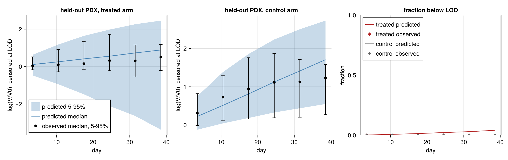
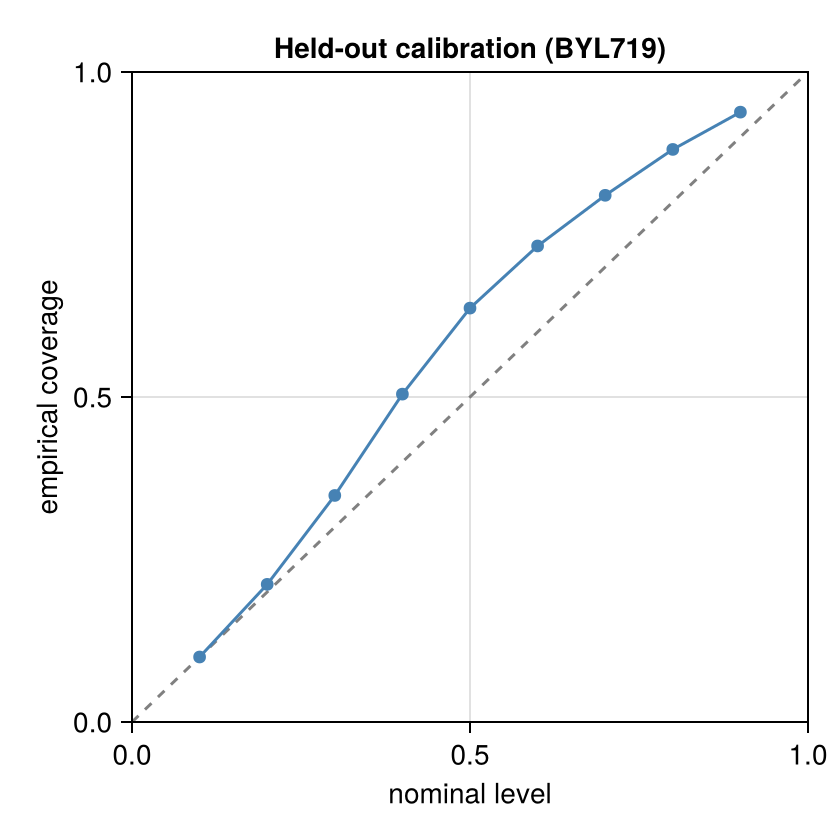
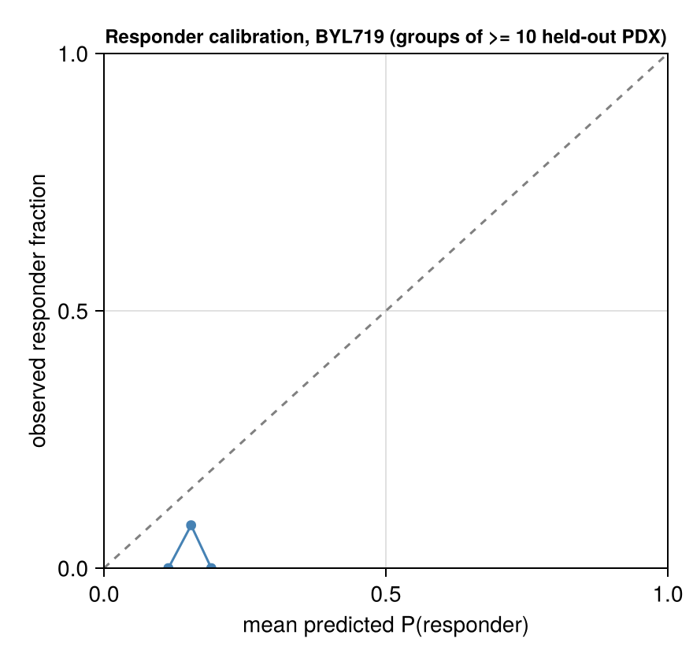

# Validation: BYL719

Generated 2026-11-05 13:29. Frozen split frac 0.2, seed 1: 38 held-out of 184 paired PDX for this drug; 200 common predictive draws.

Design: the **primary** fit (frozen stratified 80% of PDX, days ≤ 42 only) predicts the held-out 20% PDX; held-out PDX are therefore scored on days ≤ 42 only, and the observed response categories below are recomputed on that window. The **late21** fit (same 80%, days ≤ 21) forecasts days 22–42 of its training PDX. Observation model: Student-t on log volume, censored at the detection limit. This report is aggregated: every bin and summary pools at least 10 PDX models, and there are no individual PDX ids or observations (the licensed PDXE data are not redistributed); individual-curve figures are written to the local output directory only.

## Held-out PDX predictive check (primary fit; new PDX, fresh random effects, days ≤ 42)

**New-PDX prediction**: 680 scored points (0 undetectable, scored as left-censored at LOD 4.0 mm³ in the LPD only), 76 curves, 38 PDX models; nominal level 90.0%; observation model Student-t, ν = 5.0.

| metric | value |
|---|---|
| coverage, pooled | 93.8% (PDX-cluster bootstrap 95% CI 89.2%–97.4%) |
| coverage, PDX-averaged (each PDX weighted equally) | 92.3% |
| mean interval width (log-volume) | 2.463 (NaN for 0 points) |
| mean log predictive density, finite scores (volume scale) | -6.725 over 680 points |
| LPD scores equal to -Inf (no valid draw), kept | 0; mean over all scored points incl. these: -6.725047104458647 |
| mean CRPS (mm³) | 155.158 (NaN for 0 points) |
| failed solves | 0 draw rows with non-finite values; 0 empty ensembles (counted as coverage misses) |

### log(V/V0) by day, with noise and censoring

Pooled over PDX × posterior draws; both observed and simulated volumes censored at the LOD; log(V/V0) with V0 the observed baseline. Quantiles are 5% / 50% / 95%.

| arm | days | n obs | observed log(V/V0) | predicted log(V/V0) | observed < LOD | predicted < LOD | 90% coverage |
|---|---|---|---|---|---|---|---|
| treated | 0–7 | 64 | -0.18 / 0.04 / 0.52 | -0.48 / 0.11 / 0.63 | 0.0% | 0.1% | 93.8% |
| treated | 7–14 | 67 | -0.28 / 0.10 / 0.91 | -0.94 / 0.26 / 1.18 | 0.0% | 0.7% | 97.0% |
| treated | 14–21 | 68 | -0.14 / 0.15 / 1.33 | -1.48 / 0.41 / 1.64 | 0.0% | 1.3% | 97.1% |
| treated | 21–28 | 63 | -0.22 / 0.32 / 1.72 | -2.11 / 0.55 / 1.98 | 0.0% | 2.2% | 98.4% |
| treated | 28–35 | 52 | -0.56 / 0.30 / 1.16 | -2.64 / 0.73 / 2.26 | 0.0% | 2.9% | 100.0% |
| treated | 35–42 | 47 | -0.21 / 0.51 / 1.18 | -3.37 / 0.89 / 2.46 | 0.0% | 4.0% | 100.0% |
| control | 0–7 | 66 | -0.02 / 0.31 / 0.82 | -0.12 / 0.22 / 0.75 | 0.0% | 0.0% | 86.4% |
| control | 7–14 | 66 | 0.11 / 0.73 / 1.29 | 0.04 / 0.51 / 1.38 | 0.0% | 0.0% | 93.9% |
| control | 14–21 | 69 | 0.15 / 0.94 / 1.76 | 0.18 / 0.81 / 1.86 | 0.0% | 0.0% | 89.9% |
| control | 21–28 | 56 | 0.18 / 1.11 / 1.87 | 0.33 / 1.12 / 2.23 | 0.0% | 0.0% | 92.9% |
| control | 28–35 | 35 | 0.20 / 1.13 / 1.71 | 0.44 / 1.41 / 2.50 | 0.0% | 0.0% | 88.6% |
| control | 35–42 | 27 | 0.27 / 1.23 / 1.58 | 0.55 / 1.71 / 2.73 | 0.0% | 0.0% | 81.5% |

### Response categories on held-out PDX (PDXE rules, Gao et al. 2015)

Observed and predicted categories use `pdxe_response_paper` (windows t > 10, short curves on all points) on the days ≤ 42 record; simulated volumes below the LOD are recorded as 0 like the data. This rule reproduces the published BestAvgResponse in 98.4% of PDXE curves but its BestResponse is systematically lower than the published one in ~40% of curves (published mPD scored mSD by the rule): 4-way agreement with the published labels is ~91%, responder vs non-responder ~99.9%.

Observed category counts (mCR/mPR/mSD/mPD): 0/1/25/12 over 38 held-out PDX.

| metric | value |
|---|---|
| Kendall τ_b (predicted expected ordinal score vs observed ordinal) | 0.328 |
| AUROC responder (mCR/mPR) vs rest, ranked by predicted P(responder) | 0.500 (same score; cluster-bootstrap 95% CI 0.351–0.653) |
| modal predicted category = observed category | 47.4% |
| vs the published (full follow-up) categories: τ_b / AUROC | 0.248 / 0.500 (n=38) |
| predicted responder fraction (common posterior draws across models) | 15.3% (5.3%–23.7%); 0 failed model-draws excluded |
| observed responder fraction | 2.6% |

Confusion matrix (rows observed, columns modal predicted category):

| | mCR | mPR | mSD | mPD |
|---|---|---|---|---|
| mCR | 0 | 0 | 0 | 0 |
| mPR | 0 | 0 | 0 | 1 |
| mSD | 0 | 0 | 9 | 16 |
| mPD | 0 | 0 | 3 | 9 |

## Forecast of days 22–42 from the late21 fit (known tumours)

**Late-21 forecast**: 1077 scored points (1 undetectable, scored as left-censored at LOD 4.0 mm³ in the LPD only), 250 curves, 135 PDX models; nominal level 90.0%; observation model Student-t, ν = 5.0.

| metric | value |
|---|---|
| coverage, pooled | 70.4% (PDX-cluster bootstrap 95% CI 65.5%–74.9%) |
| coverage, PDX-averaged (each PDX weighted equally) | 69.1% |
| mean interval width (log-volume) | 0.645 (NaN for 0 points) |
| mean log predictive density, finite scores (volume scale) | -6.755 over 1078 points |
| LPD scores equal to -Inf (no valid draw), kept | 0; mean over all scored points incl. these: -6.755328808740287 |
| mean CRPS (mm³) | 113.965 (NaN for 0 points) |
| failed solves | 0 draw rows with non-finite values; 0 empty ensembles (counted as coverage misses) |

### log(V/V0) by day, late-21 forecast

Pooled over PDX × posterior draws; both observed and simulated volumes censored at the LOD; log(V/V0) with V0 the observed baseline. Quantiles are 5% / 50% / 95%.

| arm | days | n obs | observed log(V/V0) | predicted log(V/V0) | observed < LOD | predicted < LOD | 90% coverage |
|---|---|---|---|---|---|---|---|
| treated | 21–28 | 221 | -0.82 / 0.39 / 1.24 | -1.03 / 0.32 / 1.32 | 0.0% | 0.0% | 80.5% |
| treated | 28–35 | 198 | -0.66 / 0.46 / 1.28 | -1.28 / 0.33 / 1.42 | 0.0% | 0.0% | 67.7% |
| treated | 35–42 | 185 | -0.91 / 0.51 / 1.46 | -1.71 / 0.29 / 1.58 | 0.0% | 0.6% | 57.3% |
| control | 21–28 | 199 | 0.23 / 1.16 / 1.79 | 0.30 / 1.18 / 1.94 | 0.0% | 0.0% | 84.9% |
| control | 28–35 | 162 | 0.25 / 1.20 / 1.90 | 0.27 / 1.31 / 2.15 | 0.0% | 0.0% | 66.7% |
| control | 35–42 | 113 | 0.21 / 1.23 / 1.82 | 0.37 / 1.39 / 2.31 | 0.9% | 0.0% | 56.2% |

## Convergence

**Primary fit** (8 chains, 2000 stored draws, 250 per chain)

| item | recorded by the fit |
|---|---|
| max R-hat (all parameters) | 1.015 |
| min bulk ESS | 661.8 |
| min tail ESS | 729.2 |
| divergent transitions | 0 |
| E-BFMI (min over chains) | 0.6981 |
| tree-depth cap hits | 0 |
| mean tree depth | 7.021 |
| mean acceptance | 0.9117 |
| mean step size | 0.04192 |
| mean leapfrog steps | 134.2 |
| cross-mode R-hat | 1.013 |
| MAP log-densities of the starts | [707.8642855167169, 735.3201552323372, 734.769724157198, 732.9247104917681, 737.2222406528595] |
| mode_lps | [737.2222406528595, 735.3201552323372, 734.769724157198, 732.9247104917681, 707.8642855167169] |
| rhat_by_warmup_chain | 1.013 |

Recomputed from the stored draws of the hyperparameters (chain layout from `nchains`):

| parameter | R-hat | bulk ESS | tail ESS |
|---|---|---|---|
| μ_λ0 | 1.009 | 3201 | 1335 |
| ω_λ0 | 1.002 | 2534 | 1700 |
| μ_k2 | 1.000 | 2617 | 1663 |
| ω_k2 | 1.002 | 1711 | 1600 |
| logλ1 | 1.008 | 589 | 955 |
| logk1 | 1.003 | 4306 | 1554 |
| σ | 1.002 | 2276 | 1850 |

**Convergence flags: max R-hat 1.015 > 1.01; min bulk ESS 661.8 < 100 per chain; cross-mode R-hat 1.013 > 1.01**

**Late-21 fit** (8 chains, 2000 stored draws, 250 per chain)

| item | recorded by the fit |
|---|---|
| max R-hat (all parameters) | 1.015 |
| min bulk ESS | 780.9 |
| min tail ESS | 851.2 |
| divergent transitions | 0 |
| E-BFMI (min over chains) | 0.7859 |
| tree-depth cap hits | 0 |
| mean tree depth | 6 |
| mean acceptance | 0.8784 |
| mean step size | 0.07883 |
| mean leapfrog steps | 63 |
| cross-mode R-hat | 1.011 |
| MAP log-densities of the starts | [480.90704308133127, 500.7229636987211, 506.00571829253056, 500.8232595104691, 506.12550040118435] |
| mode_lps | [506.12550040118435, 500.8232595104691, 480.90704308133127] |
| rhat_by_warmup_chain | 1.011 |

Recomputed from the stored draws of the hyperparameters (chain layout from `nchains`):

| parameter | R-hat | bulk ESS | tail ESS |
|---|---|---|---|
| μ_λ0 | 1.002 | 3578 | 1268 |
| ω_λ0 | 1.000 | 1731 | 1633 |
| μ_k2 | 1.000 | 1924 | 1588 |
| ω_k2 | 1.000 | 1064 | 1567 |
| logλ1 | 1.009 | 731 | 794 |
| logk1 | 1.000 | 4250 | 1714 |
| σ | 1.000 | 2302 | 1584 |

**Convergence flags: max R-hat 1.015 > 1.01; min bulk ESS 780.9 < 100 per chain; cross-mode R-hat 1.011 > 1.01**

## PSIS-LOO (primary fit, training PDX, days ≤ 42)

**Conditional, one unit per PDX model (random effects fixed at their draws)**: elpd = 918.0 ± 140.4, p_eff = 553.9, n = 146; Pareto-k ≤0.5 / 0.5–0.7 / 0.7–1 / >1: 0/3/45/98. Units with k > 0.7 need exact refits before trusting elpd.

Marginal, one unit per PDX model (random effects integrated; new-PDX LOO): not computed.

## Figures

