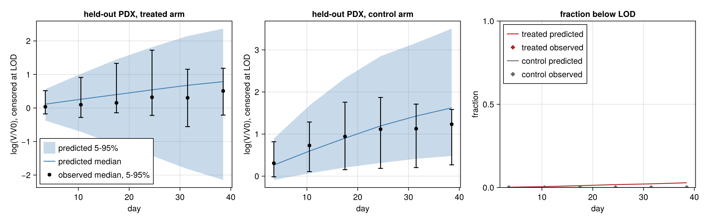
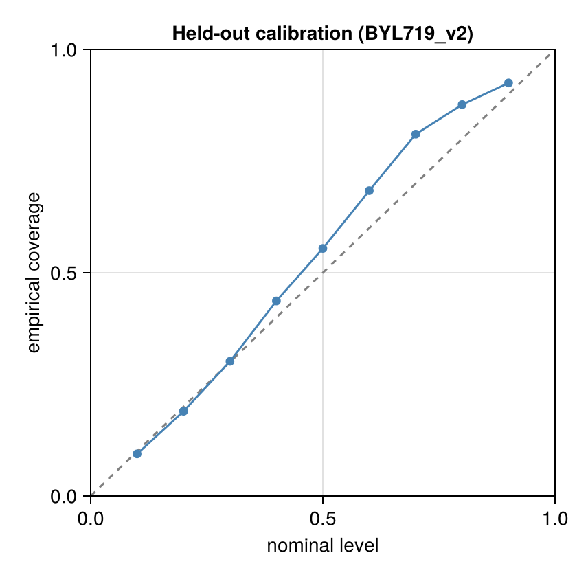
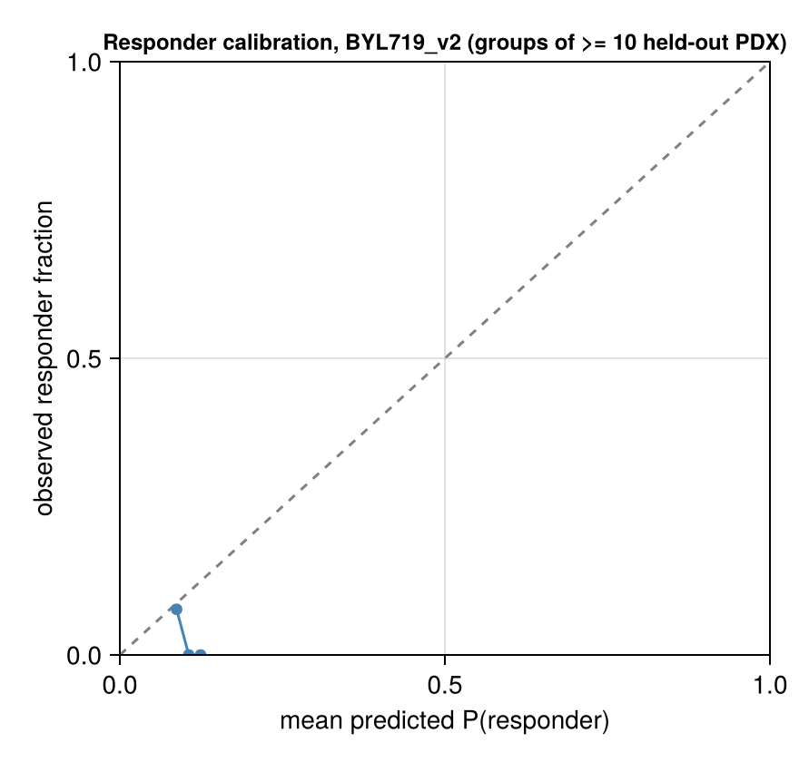

# Validation: BYL719_v2

Generated 2026-11-08 12:08. Fits: `fits` (files `*_v2.jld2`). Model: v2. Frozen split frac 0.2, seed 1: 38 held-out of 184 paired PDX for this drug. Predictive draws used (of 1000 / 2000 stored in the primary / late21 fit): 200 for the held-out curve check, 200 for the late21 forecast, 1000 for the response section.

Design: the **primary** fit (frozen stratified 80% of PDX, days ≤ 42 only) predicts the held-out 20% PDX; held-out PDX are therefore scored on days ≤ 42 only, and the observed response categories below are recomputed on that window. The **late21** fit (same 80%, days ≤ 21) forecasts days 22–42 of its training PDX. Observation model: Student-t on log volume, censored at the detection limit. This report is aggregated: every bin and summary pools at least 10 PDX models, and there are no individual PDX ids or observations (the licensed PDXE data are not redistributed); individual-curve figures are written to the local output directory only.

## Held-out PDX predictive check (primary fit; new PDX, fresh random effects, days ≤ 42)

**New-PDX prediction**: 680 scored points (0 undetectable, scored as left-censored at LOD 4.0 mm³ in the LPD only), 76 curves, 38 PDX models; nominal level 90.0%; observation model Student-t, ν = 5.0.

| metric | value |
|---|---|
| coverage, pooled | 92.5% (PDX-cluster bootstrap 95% CI 87.8%–96.4%) |
| coverage, PDX-averaged (each PDX weighted equally) | 90.8% |
| mean interval width (log-volume) | 2.306 (NaN for 0 points) |
| mean log predictive density, finite scores (volume scale) | -6.672 over 680 points |
| LPD scores equal to -Inf (no valid draw), kept | 0; mean over all scored points incl. these: -6.672459046029597 |
| mean CRPS (mm³) | 153.096 (NaN for 0 points) |
| failed solves | 0 draw rows with non-finite values; 0 empty ensembles (counted as coverage misses) |

### log(V/V0) by day, with noise and censoring

Pooled over PDX × posterior draws; both observed and simulated volumes censored at the LOD; log(V/V0) with V0 the observed baseline. Quantiles are 5% / 50% / 95%. Tail calibration: fraction of observed positive volumes below the predictive 5% quantile / above the 95% quantile (nominal 5% / 5%). Below the 5% quantile = tumours smaller than predicted (they shrink more or grow less than the predictive lower tail allows); excess regrowth shows in the upper tail (above the 95% quantile).

| arm | days | n obs (PDX) | observed log(V/V0) | predicted log(V/V0) | observed < LOD | predicted < LOD | 90% coverage | below 5% / above 95% |
|---|---|---|---|---|---|---|---|---|
| treated | 0–7 | 64 (38) | -0.18 / 0.04 / 0.52 | -0.38 / 0.12 / 0.56 | 0.0% | 0.2% | 95.3% | 0.0% / 4.7% |
| treated | 7–14 | 67 (37) | -0.28 / 0.10 / 0.91 | -0.71 / 0.26 / 1.02 | 0.0% | 0.6% | 89.6% | 1.5% / 9.0% |
| treated | 14–21 | 68 (38) | -0.14 / 0.15 / 1.33 | -1.10 / 0.40 / 1.45 | 0.0% | 1.1% | 94.1% | 1.5% / 4.4% |
| treated | 21–28 | 63 (35) | -0.22 / 0.32 / 1.72 | -1.42 / 0.54 / 1.81 | 0.0% | 1.8% | 92.1% | 0.0% / 7.9% |
| treated | 28–35 | 52 (30) | -0.56 / 0.30 / 1.16 | -1.82 / 0.68 / 2.14 | 0.0% | 2.2% | 100.0% | 0.0% / 0.0% |
| treated | 35–42 | 47 (26) | -0.21 / 0.51 / 1.18 | -2.15 / 0.79 / 2.37 | 0.0% | 2.9% | 100.0% | 0.0% / 0.0% |
| control | 0–7 | 66 (37) | -0.02 / 0.31 / 0.82 | -0.09 / 0.26 / 0.89 | 0.0% | 0.0% | 89.4% | 4.5% / 6.1% |
| control | 7–14 | 66 (37) | 0.11 / 0.73 / 1.29 | 0.07 / 0.60 / 1.68 | 0.0% | 0.0% | 92.4% | 4.5% / 3.0% |
| control | 14–21 | 69 (35) | 0.15 / 0.94 / 1.76 | 0.20 / 0.90 / 2.33 | 0.0% | 0.0% | 89.9% | 10.1% / 0.0% |
| control | 21–28 | 56 (30) | 0.18 / 1.11 / 1.87 | 0.31 / 1.19 / 2.85 | 0.0% | 0.0% | 92.9% | 7.1% / 0.0% |
| control | 28–35 | 35 (21) | 0.20 / 1.13 / 1.71 | 0.41 / 1.43 / 3.16 | 0.0% | 0.0% | 88.6% | 11.4% / 0.0% |
| control | 35–42 | 27 (16) | 0.27 / 1.23 / 1.58 | 0.48 / 1.62 / 3.51 | 0.0% | 0.0% | 81.5% | 18.5% / 0.0% |

### Residuals by day, held-out PDX

Median signed log residual, `log y - median log(predictive)` per observation, reduced to one median per PDX in the bin, then the median across PDX (each PDX equal weight; 90% PDX-bootstrap interval). The balanced-panel column uses only PDX observed in every bin of the arm, so changes between bins are within-PDX rather than a changing mix of PDX. Positive = observed larger than predicted.

| arm | days | PDX | median residual (90% interval) | balanced panel (PDX) median residual |
|---|---|---|---|---|
| treated | 0–7 | 38 | -0.066 (-0.109, +0.014) | -0.099 (23) |
| treated | 7–14 | 37 | -0.136 (-0.206, +0.015) | -0.200 (23) |
| treated | 14–21 | 38 | -0.227 (-0.294, +0.028) | -0.294 (23) |
| treated | 21–28 | 35 | -0.257 (-0.387, -0.018) | -0.387 (23) |
| treated | 28–35 | 30 | -0.329 (-0.545, -0.178) | -0.339 (23) |
| treated | 35–42 | 26 | -0.404 (-0.613, -0.103) | -0.455 (23) |
| control | 0–7 | 37 | +0.091 (-0.001, +0.135) | -0.076 (15) |
| control | 7–14 | 37 | +0.111 (+0.011, +0.217) | -0.152 (15) |
| control | 14–21 | 35 | +0.053 (-0.104, +0.282) | -0.234 (15) |
| control | 21–28 | 30 | -0.083 (-0.208, +0.256) | -0.344 (15) |
| control | 28–35 | 21 | -0.342 (-0.450, -0.140) | -0.379 (15) |
| control | 35–42 | 16 | -0.339 (-0.772, -0.245) | -0.324 (15) |

### Response categories on held-out PDX (PDXE rules, Gao et al. 2015)

Observed and predicted categories use `pdxe_response_paper` (windows t > 10, short curves on all points) on the days ≤ 42 record; simulated volumes below the LOD are recorded as 0 like the data and the day-0 volume is the observed one. This rule reproduces the published BestAvgResponse in 98.4% of PDXE curves but its BestResponse is systematically lower than the published one in ~40% of curves (published mPD scored mSD by the rule): 4-way agreement with the published labels is ~91%, responder vs non-responder ~99.9%.

**Recorded response** = categories of simulated noisy observations (the prediction of what would be recorded). **Latent response** = categories of the noise-free trajectories, every draw classified; it is a sensitivity line that isolates the contribution of observation noise (same random effects, same LOD recording and baseline convention), not a prediction of recorded categories. 1000 common posterior draws; response section runtime 139.3 s.

Observed category counts (mCR/mPR/mSD/mPD): 0/1/25/12 over 38 held-out PDX (1 responder).

Responder fractions (all intervals are **posterior predictive, including finite-cohort variability**, 90%):

| | held-out PDX (new, n=38) | training PDX (known random effects, in-sample, n=146) |
|---|---|---|
| observed responder fraction | 2.6% | 6.8% |
| predicted, recorded response (noisy) | 10.6% (2.6%–21.1%) | 6.4% (4.8%–8.2%) |
| predicted, latent response (noise-free) | 10.1% (2.6%–18.4%) | 4.4% (4.1%–4.8%) |

0 failed model-draws excluded (held-out, recorded).

| metric | value |
|---|---|
| Kendall τ_b (predicted expected ordinal score vs observed ordinal) | 0.306 (latent: 0.302) |
| AUROC responder (mCR/mPR) vs rest, ranked by predicted P(responder) | 0.243 (same score; cluster-bootstrap 95% CI 0.108–0.384; 38.0% of replicates had no responder or no non-responder and were dropped; latent: 0.189) |
| constant-risk benchmark | AUROC 0.5 by construction. Brier score: model 0.033; constant risk at the mean predicted P(responder) = 0.106: 0.032; prevalence-oracle reference 0.026 |
| modal predicted category = observed category | 71.1% |
| vs the published (full follow-up) categories: τ_b / AUROC | 0.191 / 0.375 (n=38) |

**No demonstrated responder discrimination for new PDX (exchangeable random effects, no covariates). Only one held-out responder: the AUROC is just the rank of that single PDX, and the cluster bootstrap conditional on one positive PDX is not informative (its interval is not evidence of discrimination).**

Confusion matrix (rows observed, columns modal predicted category):

| | mCR | mPR | mSD | mPD |
|---|---|---|---|---|
| mCR | 0 | 0 | 0 | 0 |
| mPR | 0 | 0 | 0 | 1 |
| mSD | 0 | 0 | 18 | 7 |
| mPD | 0 | 0 | 3 | 9 |

## Forecast of days 22–42 from the late21 fit (known tumours)

**Late-21 forecast**: 1077 scored points (1 undetectable, scored as left-censored at LOD 4.0 mm³ in the LPD only), 250 curves, 135 PDX models; nominal level 90.0%; observation model Student-t, ν = 5.0.

| metric | value |
|---|---|
| coverage, pooled | 74.3% (PDX-cluster bootstrap 95% CI 69.8%–78.7%) |
| coverage, PDX-averaged (each PDX weighted equally) | 73.3% |
| mean interval width (log-volume) | 0.643 (NaN for 0 points) |
| mean log predictive density, finite scores (volume scale) | -6.535 over 1078 points |
| LPD scores equal to -Inf (no valid draw), kept | 0; mean over all scored points incl. these: -6.534752569141962 |
| mean CRPS (mm³) | 89.869 (NaN for 0 points) |
| failed solves | 0 draw rows with non-finite values; 0 empty ensembles (counted as coverage misses) |

### log(V/V0) by day, late-21 forecast

Pooled over PDX × posterior draws; both observed and simulated volumes censored at the LOD; log(V/V0) with V0 the observed baseline. Quantiles are 5% / 50% / 95%. Tail calibration: fraction of observed positive volumes below the predictive 5% quantile / above the 95% quantile (nominal 5% / 5%). Below the 5% quantile = tumours smaller than predicted (they shrink more or grow less than the predictive lower tail allows); excess regrowth shows in the upper tail (above the 95% quantile).

| arm | days | n obs (PDX) | observed log(V/V0) | predicted log(V/V0) | observed < LOD | predicted < LOD | 90% coverage | below 5% / above 95% |
|---|---|---|---|---|---|---|---|---|
| treated | 21–28 | 221 (126) | -0.82 / 0.39 / 1.24 | -0.99 / 0.31 / 1.24 | 0.0% | 0.0% | 79.6% | 4.1% / 16.3% |
| treated | 28–35 | 198 (113) | -0.66 / 0.46 / 1.28 | -1.18 / 0.32 / 1.29 | 0.0% | 0.0% | 65.2% | 5.1% / 29.8% |
| treated | 35–42 | 185 (104) | -0.91 / 0.51 / 1.46 | -1.49 / 0.27 / 1.41 | 0.0% | 0.3% | 56.8% | 4.3% / 38.9% |
| control | 21–28 | 199 (115) | 0.23 / 1.16 / 1.79 | 0.25 / 1.11 / 1.84 | 0.0% | 0.0% | 88.9% | 5.5% / 5.5% |
| control | 28–35 | 162 (96) | 0.25 / 1.20 / 1.90 | 0.16 / 1.18 / 1.99 | 0.0% | 0.0% | 79.6% | 10.5% / 9.9% |
| control | 35–42 | 113 (70) | 0.21 / 1.23 / 1.82 | 0.23 / 1.20 / 2.10 | 0.9% | 0.0% | 75.0% | 17.0% / 8.0% |

### Within-PDX residuals by day, late-21 forecast

Median signed log residual, `log y - median log(predictive)` per observation, reduced to one median per PDX in the bin, then the median across PDX (each PDX equal weight; 90% PDX-bootstrap interval). The balanced-panel column uses only PDX observed in every bin of the arm, so changes between bins are within-PDX rather than a changing mix of PDX. Positive = observed larger than predicted.

| arm | days | PDX | median residual (90% interval) | balanced panel (PDX) median residual |
|---|---|---|---|---|
| treated | 21–28 | 126 | +0.070 (+0.037, +0.103) | +0.074 (100) |
| treated | 28–35 | 113 | +0.166 (+0.127, +0.218) | +0.161 (100) |
| treated | 35–42 | 104 | +0.210 (+0.135, +0.305) | +0.220 (100) |
| control | 21–28 | 115 | +0.010 (-0.022, +0.031) | -0.005 (61) |
| control | 28–35 | 96 | +0.008 (-0.045, +0.038) | -0.031 (61) |
| control | 35–42 | 69 | -0.042 (-0.100, +0.008) | -0.023 (61) |

## Convergence

**Primary fit** (20 chains, 1000 stored draws, 50 per chain)

| item | recorded by the fit |
|---|---|
| max R-hat (all parameters) | 1.57 |
| min bulk ESS | 42.93 |
| min tail ESS | 47.37 |
| divergent transitions | 0 |
| E-BFMI (min over chains) | 0.5585 |
| tree-depth cap hits | 111 |
| mean tree depth | 8.379 |
| mean acceptance | 0.9302 |
| mean step size | 0.01377 |
| mean leapfrog steps | 424.5 |
| cross-mode R-hat | 1.537 |
| MAP log-densities of the starts | [856.1856133345202, 847.3543677378931, 821.6853630891917, 814.6544989753172, 827.7387763715213] |
| mode_gap | Inf |
| mode_lps | [856.1856133345202, 847.3543677378931, 827.7387763715213] |
| rhat_by_warmup_chain | 1.537 |

Recomputed from the stored draws of the hyperparameters (chain layout from `nchains`):

| parameter | R-hat | bulk ESS | tail ESS |
|---|---|---|---|
| μ_λ0 | 1.096 | 164 | 219 |
| ω_λ0 | 1.043 | 311 | 752 |
| μ_k2 | 1.013 | 794 | 863 |
| ω_k2 | 1.018 | 812 | 778 |
| logλ1 | 1.032 | 358 | 563 |
| logk1 | 1.030 | 1181 | 367 |
| σ | 1.009 | 1025 | 866 |
| corr(log λ0, log k2) | 1.053 | 268 | 750 |
| μ_logVtr | 1.074 | 224 | 280 |
| ω_Vtr | 1.062 | 277 | 317 |

**Convergence flags: max R-hat 1.57 > 1.01; min bulk ESS 42.93 < 100 per chain; cross-mode R-hat 1.537 > 1.01; recomputed hyperparameter R-hat > 1.01**

**Late-21 fit** (8 chains, 2000 stored draws, 250 per chain)

| item | recorded by the fit |
|---|---|
| max R-hat (all parameters) | 1.068 |
| min bulk ESS | 82.93 |
| min tail ESS | 111.7 |
| divergent transitions | 0 |
| E-BFMI (min over chains) | 0.6655 |
| tree-depth cap hits | 0 |
| mean tree depth | 7.122 |
| mean acceptance | 0.8982 |
| mean step size | 0.03105 |
| mean leapfrog steps | 163.5 |
| cross-mode R-hat | 1.048 |
| MAP log-densities of the starts | [485.2016461647924, 469.1478642650861, 480.90799295382294, 481.112939070961, 483.317581404436] |
| mode_gap | Inf |
| mode_lps | [485.2016461647924, 483.317581404436, 481.112939070961, 469.1478642650861] |
| rhat_by_warmup_chain | 1.048 |

Recomputed from the stored draws of the hyperparameters (chain layout from `nchains`):

| parameter | R-hat | bulk ESS | tail ESS |
|---|---|---|---|
| μ_λ0 | 1.068 | 83 | 313 |
| ω_λ0 | 1.042 | 176 | 759 |
| μ_k2 | 1.005 | 917 | 1469 |
| ω_k2 | 1.008 | 939 | 1542 |
| logλ1 | 1.026 | 287 | 914 |
| logk1 | 1.001 | 2835 | 1278 |
| σ | 1.004 | 1555 | 1565 |
| corr(log λ0, log k2) | 1.016 | 440 | 1072 |
| μ_logVtr | 1.052 | 118 | 318 |
| ω_Vtr | 1.036 | 320 | 764 |

**Convergence flags: max R-hat 1.068 > 1.01; min bulk ESS 82.93 < 100 per chain; cross-mode R-hat 1.048 > 1.01; recomputed hyperparameter R-hat > 1.01**

## PSIS-LOO (primary fit, training PDX, days ≤ 42)

**Conditional, one unit per PDX model (random effects fixed at their draws)**: elpd = 1131.9 ± 145.4, p_eff = 525.5, n = 146; Pareto-k ≤0.5 / 0.5–0.7 / 0.7–1 / >1: 0/2/64/80. Units with k > 0.7 need exact refits before trusting elpd.

Marginal, one unit per PDX model (random effects integrated; new-PDX LOO): not computed.

## Figures

