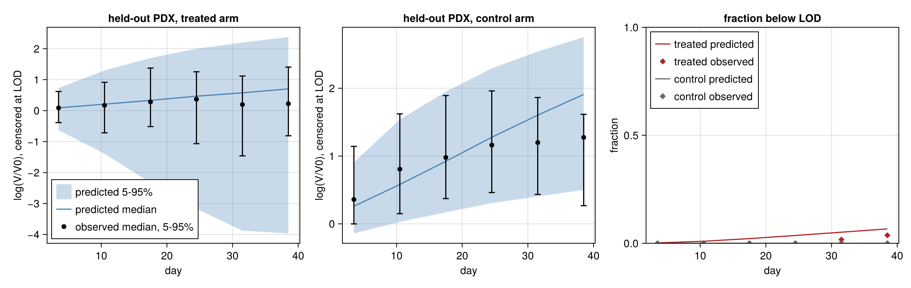
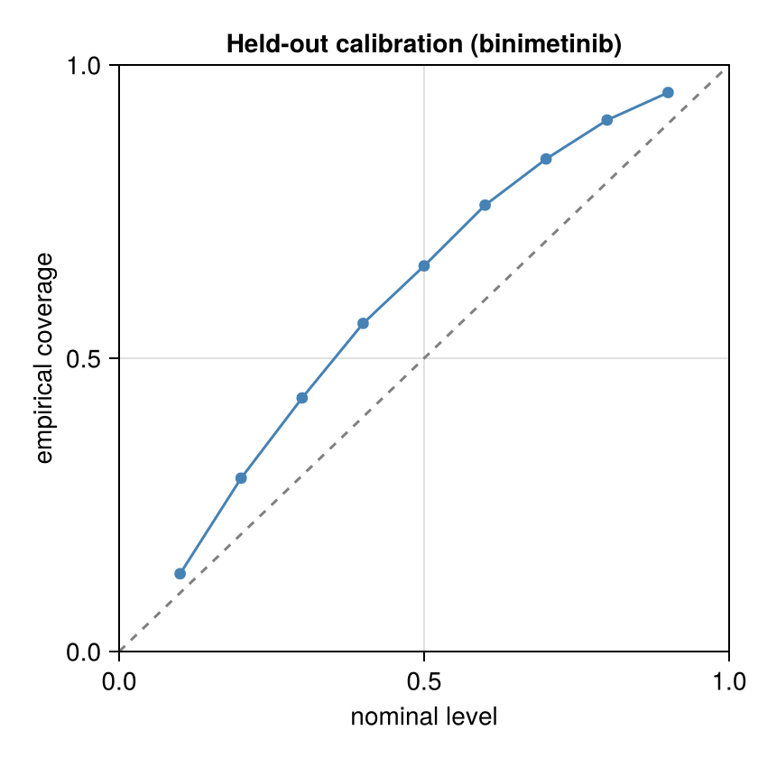
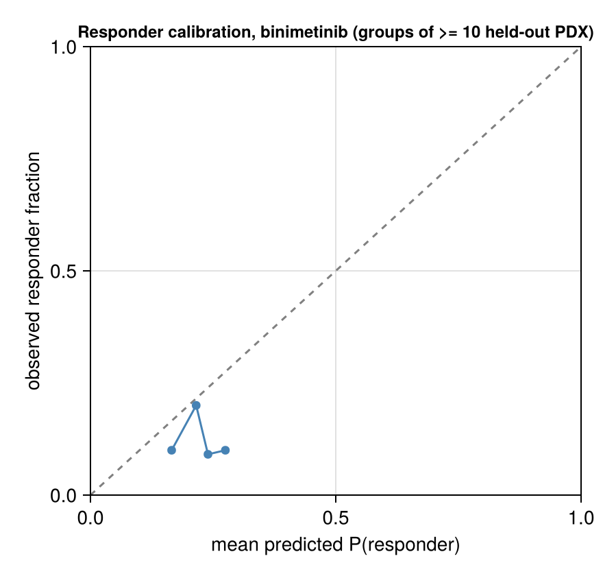

# Validation: binimetinib

Generated 2026-11-05 13:29. Frozen split frac 0.2, seed 1: 41 held-out of 200 paired PDX for this drug; 200 common predictive draws.

Design: the **primary** fit (frozen stratified 80% of PDX, days ≤ 42 only) predicts the held-out 20% PDX; held-out PDX are therefore scored on days ≤ 42 only, and the observed response categories below are recomputed on that window. The **late21** fit (same 80%, days ≤ 21) forecasts days 22–42 of its training PDX. Observation model: Student-t on log volume, censored at the detection limit. This report is aggregated: every bin and summary pools at least 10 PDX models, and there are no individual PDX ids or observations (the licensed PDXE data are not redistributed); individual-curve figures are written to the local output directory only.

## Held-out PDX predictive check (primary fit; new PDX, fresh random effects, days ≤ 42)

**New-PDX prediction**: 724 scored points (3 undetectable, scored as left-censored at LOD 4.0 mm³ in the LPD only), 82 curves, 41 PDX models; nominal level 90.0%; observation model Student-t, ν = 5.0.

| metric | value |
|---|---|
| coverage, pooled | 95.3% (PDX-cluster bootstrap 95% CI 92.0%–98.0%) |
| coverage, PDX-averaged (each PDX weighted equally) | 92.1% |
| mean interval width (log-volume) | 3.058 (NaN for 0 points) |
| mean log predictive density, finite scores (volume scale) | -6.842 over 727 points |
| LPD scores equal to -Inf (no valid draw), kept | 0; mean over all scored points incl. these: -6.8422994554581775 |
| mean CRPS (mm³) | 170.185 (NaN for 0 points) |
| failed solves | 0 draw rows with non-finite values; 0 empty ensembles (counted as coverage misses) |

### log(V/V0) by day, with noise and censoring

Pooled over PDX × posterior draws; both observed and simulated volumes censored at the LOD; log(V/V0) with V0 the observed baseline. Quantiles are 5% / 50% / 95%.

| arm | days | n obs | observed log(V/V0) | predicted log(V/V0) | observed < LOD | predicted < LOD | 90% coverage |
|---|---|---|---|---|---|---|---|
| treated | 0–7 | 72 | -0.39 / 0.09 / 0.62 | -0.63 / 0.09 / 0.73 | 0.0% | 0.2% | 94.4% |
| treated | 7–14 | 77 | -0.72 / 0.17 / 0.91 | -1.39 / 0.21 / 1.30 | 0.0% | 0.9% | 98.7% |
| treated | 14–21 | 76 | -0.51 / 0.28 / 1.37 | -2.33 / 0.33 / 1.70 | 0.0% | 2.2% | 97.4% |
| treated | 21–28 | 66 | -1.07 / 0.37 / 1.25 | -3.17 / 0.46 / 2.00 | 0.0% | 3.6% | 100.0% |
| treated | 28–35 | 59 | -1.46 / 0.20 / 1.12 | -3.88 / 0.57 / 2.20 | 1.7% | 5.1% | 100.0% |
| treated | 35–42 | 54 | -0.81 / 0.22 / 1.41 | -3.97 / 0.70 / 2.37 | 3.7% | 6.7% | 100.0% |
| control | 0–7 | 70 | -0.00 / 0.36 / 1.14 | -0.14 / 0.26 / 0.91 | 0.0% | 0.0% | 85.7% |
| control | 7–14 | 71 | 0.15 / 0.81 / 1.62 | 0.03 / 0.58 / 1.54 | 0.0% | 0.0% | 91.5% |
| control | 14–21 | 70 | 0.37 / 0.98 / 1.89 | 0.17 / 0.92 / 1.95 | 0.0% | 0.0% | 94.3% |
| control | 21–28 | 54 | 0.46 / 1.16 / 1.96 | 0.31 / 1.28 / 2.29 | 0.0% | 0.0% | 96.3% |
| control | 28–35 | 32 | 0.43 / 1.20 / 1.86 | 0.40 / 1.60 / 2.54 | 0.0% | 0.0% | 93.8% |
| control | 35–42 | 26 | 0.27 / 1.28 / 1.62 | 0.50 / 1.91 / 2.75 | 0.0% | 0.0% | 88.5% |

### Response categories on held-out PDX (PDXE rules, Gao et al. 2015)

Observed and predicted categories use `pdxe_response_paper` (windows t > 10, short curves on all points) on the days ≤ 42 record; simulated volumes below the LOD are recorded as 0 like the data. This rule reproduces the published BestAvgResponse in 98.4% of PDXE curves but its BestResponse is systematically lower than the published one in ~40% of curves (published mPD scored mSD by the rule): 4-way agreement with the published labels is ~91%, responder vs non-responder ~99.9%.

Observed category counts (mCR/mPR/mSD/mPD): 1/4/22/14 over 41 held-out PDX.

| metric | value |
|---|---|
| Kendall τ_b (predicted expected ordinal score vs observed ordinal) | 0.230 |
| AUROC responder (mCR/mPR) vs rest, ranked by predicted P(responder) | 0.433 (same score; cluster-bootstrap 95% CI 0.227–0.707) |
| modal predicted category = observed category | 46.3% |
| vs the published (full follow-up) categories: τ_b / AUROC | 0.193 / 0.521 (n=41) |
| predicted responder fraction (common posterior draws across models) | 22.4% (12.2%–34.1%); 0 failed model-draws excluded |
| observed responder fraction | 12.2% |

Confusion matrix (rows observed, columns modal predicted category):

| | mCR | mPR | mSD | mPD |
|---|---|---|---|---|
| mCR | 0 | 0 | 0 | 1 |
| mPR | 0 | 0 | 0 | 4 |
| mSD | 0 | 0 | 6 | 16 |
| mPD | 0 | 0 | 1 | 13 |

## Forecast of days 22–42 from the late21 fit (known tumours)

**Late-21 forecast**: 1116 scored points (7 undetectable, scored as left-censored at LOD 4.0 mm³ in the LPD only), 266 curves, 149 PDX models; nominal level 90.0%; observation model Student-t, ν = 5.0.

| metric | value |
|---|---|
| coverage, pooled | 74.0% (PDX-cluster bootstrap 95% CI 69.2%–78.7%) |
| coverage, PDX-averaged (each PDX weighted equally) | 73.6% |
| mean interval width (log-volume) | 0.739 (NaN for 0 points) |
| mean log predictive density, finite scores (volume scale) | -6.616 over 1123 points |
| LPD scores equal to -Inf (no valid draw), kept | 0; mean over all scored points incl. these: -6.615672877291629 |
| mean CRPS (mm³) | 108.840 (NaN for 0 points) |
| failed solves | 0 draw rows with non-finite values; 0 empty ensembles (counted as coverage misses) |

### log(V/V0) by day, late-21 forecast

Pooled over PDX × posterior draws; both observed and simulated volumes censored at the LOD; log(V/V0) with V0 the observed baseline. Quantiles are 5% / 50% / 95%.

| arm | days | n obs | observed log(V/V0) | predicted log(V/V0) | observed < LOD | predicted < LOD | 90% coverage |
|---|---|---|---|---|---|---|---|
| treated | 21–28 | 256 | -0.95 / 0.14 / 1.37 | -1.38 / 0.20 / 1.19 | 0.8% | 0.8% | 75.2% |
| treated | 28–35 | 214 | -1.24 / 0.17 / 1.19 | -1.91 / 0.20 / 1.35 | 0.9% | 1.0% | 70.3% |
| treated | 35–42 | 188 | -1.05 / 0.16 / 1.32 | -2.03 / 0.19 / 1.54 | 1.1% | 0.6% | 65.1% |
| control | 21–28 | 205 | 0.24 / 1.16 / 1.82 | 0.31 / 1.20 / 1.99 | 0.0% | 0.0% | 88.8% |
| control | 28–35 | 154 | 0.24 / 1.19 / 1.88 | 0.31 / 1.30 / 2.14 | 0.0% | 0.0% | 74.7% |
| control | 35–42 | 106 | 0.19 / 1.22 / 1.75 | 0.39 / 1.39 / 2.28 | 0.9% | 0.0% | 64.8% |

## Convergence

**Primary fit** (8 chains, 2000 stored draws, 250 per chain)

| item | recorded by the fit |
|---|---|
| max R-hat (all parameters) | 1.183 |
| min bulk ESS | 32.47 |
| min tail ESS | 33.54 |
| divergent transitions | 0 |
| E-BFMI (min over chains) | 0.6807 |
| tree-depth cap hits | 0 |
| mean tree depth | 7.528 |
| mean acceptance | 0.9249 |
| mean step size | 0.02924 |
| mean leapfrog steps | 211.5 |
| cross-mode R-hat | 1.143 |
| MAP log-densities of the starts | [437.37740379950924, 435.937265848428, 434.7182137845095, 440.8266649736573, 436.2798925901062] |
| mode_lps | [440.8266649736573, 437.37740379950924, 436.2798925901062, 435.937265848428, 434.7182137845095] |
| rhat_by_warmup_chain | 1.143 |

Recomputed from the stored draws of the hyperparameters (chain layout from `nchains`):

| parameter | R-hat | bulk ESS | tail ESS |
|---|---|---|---|
| μ_λ0 | 1.001 | 3360 | 1472 |
| ω_λ0 | 1.023 | 304 | 1033 |
| μ_k2 | 1.002 | 2653 | 1824 |
| ω_k2 | 1.011 | 1656 | 1657 |
| logλ1 | 1.019 | 713 | 1169 |
| logk1 | 1.004 | 2802 | 1867 |
| σ | 1.002 | 2553 | 1756 |

**Convergence flags: max R-hat 1.183 > 1.01; min bulk ESS 32.47 < 100 per chain; cross-mode R-hat 1.143 > 1.01; recomputed hyperparameter R-hat > 1.01**

**Late-21 fit** (8 chains, 2000 stored draws, 250 per chain)

| item | recorded by the fit |
|---|---|
| max R-hat (all parameters) | 1.014 |
| min bulk ESS | 924.5 |
| min tail ESS | 512 |
| divergent transitions | 0 |
| E-BFMI (min over chains) | 0.6462 |
| tree-depth cap hits | 0 |
| mean tree depth | 7.13 |
| mean acceptance | 0.9268 |
| mean step size | 0.03792 |
| mean leapfrog steps | 152 |
| cross-mode R-hat | 1.009 |
| MAP log-densities of the starts | [292.49481216340035, 62.58530063020695, 290.20797370251853, 279.1521017964728, 287.52829922589575] |
| mode_lps | [292.49481216340035, 290.20797370251853, 287.52829922589575, 279.1521017964728] |
| rhat_by_warmup_chain | 1.009 |

Recomputed from the stored draws of the hyperparameters (chain layout from `nchains`):

| parameter | R-hat | bulk ESS | tail ESS |
|---|---|---|---|
| μ_λ0 | 1.001 | 2590 | 1636 |
| ω_λ0 | 1.006 | 1440 | 1477 |
| μ_k2 | 1.001 | 1826 | 1339 |
| ω_k2 | 1.003 | 1349 | 1620 |
| logλ1 | 1.008 | 700 | 1125 |
| logk1 | 1.003 | 3295 | 1797 |
| σ | 1.003 | 1791 | 1663 |

**Convergence flags: max R-hat 1.014 > 1.01**

## PSIS-LOO (primary fit, training PDX, days ≤ 42)

**Conditional, one unit per PDX model (random effects fixed at their draws)**: elpd = 611.9 ± 133.5, p_eff = 543.3, n = 159; Pareto-k ≤0.5 / 0.5–0.7 / 0.7–1 / >1: 0/3/62/94. Units with k > 0.7 need exact refits before trusting elpd.

Marginal, one unit per PDX model (random effects integrated; new-PDX LOO): not computed.

## Figures

