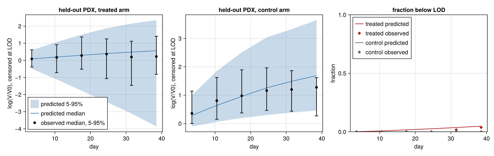
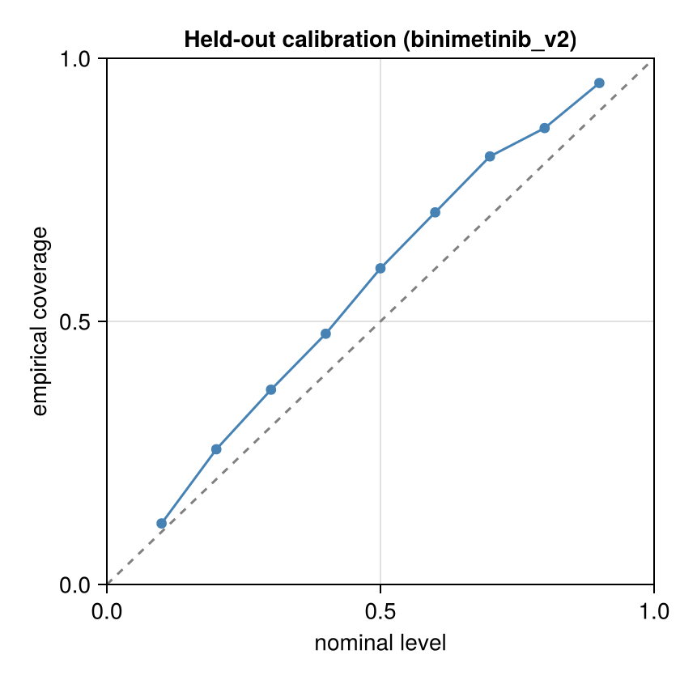
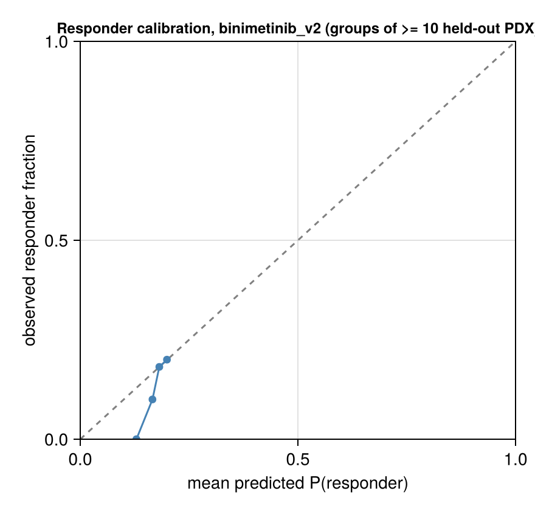

# Validation: binimetinib_v2

Generated 2026-11-08 12:17. Fits: `fits` (files `*_v2.jld2`). Model: v2. Frozen split frac 0.2, seed 1: 41 held-out of 200 paired PDX for this drug. Predictive draws used (of 1000 / 2000 stored in the primary / late21 fit): 200 for the held-out curve check, 200 for the late21 forecast, 1000 for the response section.

Design: the **primary** fit (frozen stratified 80% of PDX, days ≤ 42 only) predicts the held-out 20% PDX; held-out PDX are therefore scored on days ≤ 42 only, and the observed response categories below are recomputed on that window. The **late21** fit (same 80%, days ≤ 21) forecasts days 22–42 of its training PDX. Observation model: Student-t on log volume, censored at the detection limit. This report is aggregated: every bin and summary pools at least 10 PDX models, and there are no individual PDX ids or observations (the licensed PDXE data are not redistributed); individual-curve figures are written to the local output directory only.

## Held-out PDX predictive check (primary fit; new PDX, fresh random effects, days ≤ 42)

**New-PDX prediction**: 724 scored points (3 undetectable, scored as left-censored at LOD 4.0 mm³ in the LPD only), 82 curves, 41 PDX models; nominal level 90.0%; observation model Student-t, ν = 5.0.

| metric | value |
|---|---|
| coverage, pooled | 95.3% (PDX-cluster bootstrap 95% CI 92.2%–97.7%) |
| coverage, PDX-averaged (each PDX weighted equally) | 92.8% |
| mean interval width (log-volume) | 2.820 (NaN for 0 points) |
| mean log predictive density, finite scores (volume scale) | -6.774 over 727 points |
| LPD scores equal to -Inf (no valid draw), kept | 0; mean over all scored points incl. these: -6.7740582784199885 |
| mean CRPS (mm³) | 163.485 (NaN for 0 points) |
| failed solves | 0 draw rows with non-finite values; 0 empty ensembles (counted as coverage misses) |

### log(V/V0) by day, with noise and censoring

Pooled over PDX × posterior draws; both observed and simulated volumes censored at the LOD; log(V/V0) with V0 the observed baseline. Quantiles are 5% / 50% / 95%. Tail calibration: fraction of observed positive volumes below the predictive 5% quantile / above the 95% quantile (nominal 5% / 5%). Below the 5% quantile = tumours smaller than predicted (they shrink more or grow less than the predictive lower tail allows); excess regrowth shows in the upper tail (above the 95% quantile).

| arm | days | n obs (PDX) | observed log(V/V0) | predicted log(V/V0) | observed < LOD | predicted < LOD | 90% coverage | below 5% / above 95% |
|---|---|---|---|---|---|---|---|---|
| treated | 0–7 | 72 (41) | -0.39 / 0.09 / 0.62 | -0.49 / 0.09 / 0.59 | 0.0% | 0.1% | 88.9% | 4.2% / 6.9% |
| treated | 7–14 | 77 (40) | -0.72 / 0.17 / 0.91 | -1.11 / 0.20 / 1.07 | 0.0% | 0.7% | 92.2% | 1.3% / 6.5% |
| treated | 14–21 | 76 (40) | -0.51 / 0.28 / 1.37 | -1.77 / 0.30 / 1.51 | 0.0% | 1.7% | 97.4% | 0.0% / 2.6% |
| treated | 21–28 | 66 (35) | -1.07 / 0.37 / 1.25 | -2.43 / 0.40 / 1.87 | 0.0% | 2.6% | 98.5% | 1.5% / 0.0% |
| treated | 28–35 | 59 (34) | -1.46 / 0.20 / 1.12 | -3.10 / 0.49 / 2.15 | 1.7% | 3.6% | 100.0% | 0.0% / 0.0% |
| treated | 35–42 | 54 (29) | -0.81 / 0.22 / 1.41 | -3.86 / 0.56 / 2.35 | 3.7% | 4.8% | 100.0% | 0.0% / 0.0% |
| control | 0–7 | 70 (40) | -0.00 / 0.36 / 1.14 | -0.10 / 0.29 / 1.00 | 0.0% | 0.0% | 94.3% | 1.4% / 4.3% |
| control | 7–14 | 71 (40) | 0.15 / 0.81 / 1.62 | 0.06 / 0.64 / 1.85 | 0.0% | 0.0% | 93.0% | 1.4% / 5.6% |
| control | 14–21 | 70 (36) | 0.37 / 0.98 / 1.89 | 0.20 / 0.96 / 2.51 | 0.0% | 0.0% | 98.6% | 1.4% / 0.0% |
| control | 21–28 | 54 (30) | 0.46 / 1.16 / 1.96 | 0.30 / 1.26 / 3.04 | 0.0% | 0.0% | 96.3% | 3.7% / 0.0% |
| control | 28–35 | 32 (20) | 0.43 / 1.20 / 1.86 | 0.38 / 1.49 / 3.32 | 0.0% | 0.0% | 93.8% | 6.2% / 0.0% |
| control | 35–42 | 26 (16) | 0.27 / 1.28 / 1.62 | 0.46 / 1.69 / 3.65 | 0.0% | 0.0% | 88.5% | 11.5% / 0.0% |

### Residuals by day, held-out PDX

Median signed log residual, `log y - median log(predictive)` per observation, reduced to one median per PDX in the bin, then the median across PDX (each PDX equal weight; 90% PDX-bootstrap interval). The balanced-panel column uses only PDX observed in every bin of the arm, so changes between bins are within-PDX rather than a changing mix of PDX. Positive = observed larger than predicted.

| arm | days | PDX | median residual (90% interval) | balanced panel (PDX) median residual |
|---|---|---|---|---|
| treated | 0–7 | 41 | +0.041 (-0.109, +0.076) | -0.142 (27) |
| treated | 7–14 | 40 | -0.004 (-0.170, +0.130) | -0.151 (27) |
| treated | 14–21 | 40 | -0.054 (-0.193, +0.141) | -0.100 (27) |
| treated | 21–28 | 35 | -0.019 (-0.330, +0.171) | -0.096 (27) |
| treated | 28–35 | 34 | -0.164 (-0.500, +0.094) | -0.192 (27) |
| treated | 35–42 | 28 | -0.250 (-0.437, +0.001) | -0.236 (27) |
| control | 0–7 | 40 | +0.092 (-0.010, +0.152) | -0.083 (15) |
| control | 7–14 | 40 | +0.150 (-0.003, +0.371) | -0.129 (15) |
| control | 14–21 | 36 | +0.101 (-0.050, +0.226) | -0.308 (15) |
| control | 21–28 | 30 | -0.015 (-0.171, +0.175) | -0.373 (15) |
| control | 28–35 | 20 | -0.333 (-0.446, -0.168) | -0.440 (15) |
| control | 35–42 | 16 | -0.389 (-0.676, -0.282) | -0.385 (15) |

### Response categories on held-out PDX (PDXE rules, Gao et al. 2015)

Observed and predicted categories use `pdxe_response_paper` (windows t > 10, short curves on all points) on the days ≤ 42 record; simulated volumes below the LOD are recorded as 0 like the data and the day-0 volume is the observed one. This rule reproduces the published BestAvgResponse in 98.4% of PDXE curves but its BestResponse is systematically lower than the published one in ~40% of curves (published mPD scored mSD by the rule): 4-way agreement with the published labels is ~91%, responder vs non-responder ~99.9%.

**Recorded response** = categories of simulated noisy observations (the prediction of what would be recorded). **Latent response** = categories of the noise-free trajectories, every draw classified; it is a sensitivity line that isolates the contribution of observation noise (same random effects, same LOD recording and baseline convention), not a prediction of recorded categories. 1000 common posterior draws; response section runtime 208.0 s.

Observed category counts (mCR/mPR/mSD/mPD): 1/4/22/14 over 41 held-out PDX (5 responders).

Responder fractions (all intervals are **posterior predictive, including finite-cohort variability**, 90%):

| | held-out PDX (new, n=41) | training PDX (known random effects, in-sample, n=159) |
|---|---|---|
| observed responder fraction | 12.2% | 11.3% |
| predicted, recorded response (noisy) | 16.9% (7.3%–26.8%) | 9.4% (8.2%–11.3%) |
| predicted, latent response (noise-free) | 16.0% (7.3%–26.8%) | 7.9% (6.9%–8.8%) |

0 failed model-draws excluded (held-out, recorded).

| metric | value |
|---|---|
| Kendall τ_b (predicted expected ordinal score vs observed ordinal) | 0.349 (latent: 0.261) |
| AUROC responder (mCR/mPR) vs rest, ranked by predicted P(responder) | 0.722 (same score; cluster-bootstrap 95% CI 0.517–0.934; 0.3% of replicates had no responder or no non-responder and were dropped; latent: 0.619) |
| constant-risk benchmark | AUROC 0.5 by construction. Brier score: model 0.106; constant risk at the mean predicted P(responder) = 0.169: 0.109; prevalence-oracle reference 0.107 |
| modal predicted category = observed category | 53.7% |
| vs the published (full follow-up) categories: τ_b / AUROC | 0.307 / 0.757 (n=41) |

**The AUROC interval excludes 0.5, but predictions are population-level (exchangeable random effects, no covariates): any discrimination comes from baseline volume and measurement schedule, not from PDX-specific biology.**

Confusion matrix (rows observed, columns modal predicted category):

| | mCR | mPR | mSD | mPD |
|---|---|---|---|---|
| mCR | 0 | 0 | 1 | 0 |
| mPR | 0 | 0 | 4 | 0 |
| mSD | 0 | 0 | 22 | 0 |
| mPD | 0 | 0 | 14 | 0 |

## Forecast of days 22–42 from the late21 fit (known tumours)

**Late-21 forecast**: 1116 scored points (7 undetectable, scored as left-censored at LOD 4.0 mm³ in the LPD only), 266 curves, 148 PDX models; nominal level 90.0%; observation model Student-t, ν = 5.0.

| metric | value |
|---|---|
| coverage, pooled | 78.5% (PDX-cluster bootstrap 95% CI 74.4%–82.5%) |
| coverage, PDX-averaged (each PDX weighted equally) | 77.4% |
| mean interval width (log-volume) | 0.734 (NaN for 0 points) |
| mean log predictive density, finite scores (volume scale) | -6.406 over 1123 points |
| LPD scores equal to -Inf (no valid draw), kept | 0; mean over all scored points incl. these: -6.406187377324647 |
| mean CRPS (mm³) | 89.329 (NaN for 0 points) |
| failed solves | 0 draw rows with non-finite values; 0 empty ensembles (counted as coverage misses) |

### log(V/V0) by day, late-21 forecast

Pooled over PDX × posterior draws; both observed and simulated volumes censored at the LOD; log(V/V0) with V0 the observed baseline. Quantiles are 5% / 50% / 95%. Tail calibration: fraction of observed positive volumes below the predictive 5% quantile / above the 95% quantile (nominal 5% / 5%). Below the 5% quantile = tumours smaller than predicted (they shrink more or grow less than the predictive lower tail allows); excess regrowth shows in the upper tail (above the 95% quantile).

| arm | days | n obs (PDX) | observed log(V/V0) | predicted log(V/V0) | observed < LOD | predicted < LOD | 90% coverage | below 5% / above 95% |
|---|---|---|---|---|---|---|---|---|
| treated | 21–28 | 256 (140) | -0.95 / 0.14 / 1.37 | -1.29 / 0.20 / 1.12 | 0.8% | 0.8% | 76.8% | 7.9% / 15.4% |
| treated | 28–35 | 214 (120) | -1.24 / 0.17 / 1.19 | -1.73 / 0.19 / 1.23 | 0.9% | 0.9% | 70.3% | 10.8% / 18.9% |
| treated | 35–42 | 188 (99) | -1.05 / 0.16 / 1.32 | -1.79 / 0.18 / 1.36 | 1.1% | 0.6% | 69.4% | 10.2% / 20.4% |
| control | 21–28 | 205 (119) | 0.24 / 1.16 / 1.82 | 0.25 / 1.13 / 1.90 | 0.0% | 0.0% | 90.7% | 4.4% / 4.9% |
| control | 28–35 | 154 (91) | 0.24 / 1.19 / 1.88 | 0.23 / 1.17 / 1.98 | 0.0% | 0.0% | 86.4% | 7.8% / 5.8% |
| control | 35–42 | 106 (66) | 0.19 / 1.22 / 1.75 | 0.27 / 1.19 / 2.07 | 0.9% | 0.0% | 80.0% | 14.3% / 5.7% |

### Within-PDX residuals by day, late-21 forecast

Median signed log residual, `log y - median log(predictive)` per observation, reduced to one median per PDX in the bin, then the median across PDX (each PDX equal weight; 90% PDX-bootstrap interval). The balanced-panel column uses only PDX observed in every bin of the arm, so changes between bins are within-PDX rather than a changing mix of PDX. Positive = observed larger than predicted.

| arm | days | PDX | median residual (90% interval) | balanced panel (PDX) median residual |
|---|---|---|---|---|
| treated | 21–28 | 139 | +0.017 (-0.023, +0.057) | -0.016 (95) |
| treated | 28–35 | 119 | +0.042 (-0.038, +0.073) | +0.020 (95) |
| treated | 35–42 | 97 | +0.062 (-0.057, +0.141) | +0.062 (95) |
| control | 21–28 | 119 | -0.007 (-0.035, +0.033) | -0.031 (59) |
| control | 28–35 | 91 | +0.022 (-0.035, +0.071) | -0.038 (59) |
| control | 35–42 | 65 | -0.037 (-0.109, +0.044) | -0.028 (59) |

## Convergence

**Primary fit** (20 chains, 1000 stored draws, 50 per chain)

| item | recorded by the fit |
|---|---|
| max R-hat (all parameters) | 1.731 |
| min bulk ESS | 37.77 |
| min tail ESS | 25 |
| divergent transitions | 0 |
| E-BFMI (min over chains) | 0.6087 |
| tree-depth cap hits | 107 |
| mean tree depth | 8.607 |
| mean acceptance | 0.9305 |
| mean step size | 0.01401 |
| mean leapfrog steps | 461.6 |
| cross-mode R-hat | 1.69 |
| MAP log-densities of the starts | [499.9940342714728, -138.3060604419744, 508.87920212736475, -137.03974251931768, 448.0653277439392] |
| mode_gap | Inf |
| mode_lps | [508.87920212736475, 499.9940342714728] |
| rhat_by_warmup_chain | 1.69 |

Recomputed from the stored draws of the hyperparameters (chain layout from `nchains`):

| parameter | R-hat | bulk ESS | tail ESS |
|---|---|---|---|
| μ_λ0 | 1.018 | 692 | 830 |
| ω_λ0 | 1.085 | 170 | 903 |
| μ_k2 | 1.008 | 1165 | 872 |
| ω_k2 | 1.016 | 836 | 860 |
| logλ1 | 1.051 | 278 | 720 |
| logk1 | 1.005 | 1313 | 911 |
| σ | 1.020 | 1177 | 929 |
| corr(log λ0, log k2) | 1.013 | 811 | 876 |
| μ_logVtr | 1.086 | 168 | 333 |
| ω_Vtr | 1.035 | 439 | 751 |

**Convergence flags: max R-hat 1.731 > 1.01; min bulk ESS 37.77 < 100 per chain; cross-mode R-hat 1.69 > 1.01; recomputed hyperparameter R-hat > 1.01**

**Late-21 fit** (8 chains, 2000 stored draws, 250 per chain)

| item | recorded by the fit |
|---|---|
| max R-hat (all parameters) | 1.1 |
| min bulk ESS | 65.16 |
| min tail ESS | 33.73 |
| divergent transitions | 0 |
| E-BFMI (min over chains) | 0.5647 |
| tree-depth cap hits | 0 |
| mean tree depth | 7.25 |
| mean acceptance | 0.8982 |
| mean step size | 0.03191 |
| mean leapfrog steps | 158.9 |
| cross-mode R-hat | 1.056 |
| MAP log-densities of the starts | [283.4052812011528, 261.66515993411264, 279.53840562802486, 3.576267083345479, -667.2384067317863] |
| mode_gap | Inf |
| mode_lps | [283.4052812011528, 279.53840562802486, 261.66515993411264] |
| rhat_by_warmup_chain | 1.056 |

Recomputed from the stored draws of the hyperparameters (chain layout from `nchains`):

| parameter | R-hat | bulk ESS | tail ESS |
|---|---|---|---|
| μ_λ0 | 1.100 | 65 | 95 |
| ω_λ0 | 1.071 | 88 | 500 |
| μ_k2 | 1.013 | 735 | 1382 |
| ω_k2 | 1.008 | 938 | 1443 |
| logλ1 | 1.031 | 382 | 957 |
| logk1 | 1.003 | 2350 | 1454 |
| σ | 1.004 | 1648 | 1517 |
| corr(log λ0, log k2) | 1.029 | 204 | 764 |
| μ_logVtr | 1.075 | 94 | 434 |
| ω_Vtr | 1.075 | 84 | 34 |

**Convergence flags: max R-hat 1.1 > 1.01; min bulk ESS 65.16 < 100 per chain; cross-mode R-hat 1.056 > 1.01; recomputed hyperparameter R-hat > 1.01**

## PSIS-LOO (primary fit, training PDX, days ≤ 42)

**Conditional, one unit per PDX model (random effects fixed at their draws)**: elpd = 796.6 ± 134.5, p_eff = 523.7, n = 159; Pareto-k ≤0.5 / 0.5–0.7 / 0.7–1 / >1: 0/7/74/78. Units with k > 0.7 need exact refits before trusting elpd.

Marginal, one unit per PDX model (random effects integrated; new-PDX LOO): not computed.

## Figures

